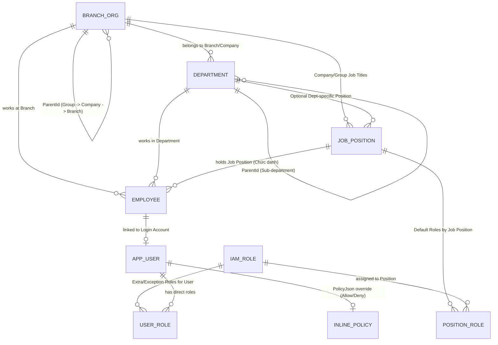

# 📋 KẾ HOẠCH PHÁT TRIỂN PHASE TIẾP THEO (STEP 20): TỔ CHỨC ĐA CẤP, CHỨC DANH & PHÂN QUYỀN ĐỘNG KIỂU AWS IAM (DYNAMIC JSON POLICY)

> **Ngày lập:** 2026-10-30  
> **Mã kế hoạch:** PLAN-STEP-20  
> **Phân hệ liên quan:** `SYS` (Hệ thống & IAM), `HRM` (Tổ chức, Phòng ban, Chức danh, Nhân sự), cùng toàn bộ 10 Submodules nghiệp vụ  
> **Đối tượng đọc:** Đội ngũ Developers (Backend .NET 10 & Frontend Angular + Ionic)  
> **Trạng thái:** Đã lên kế hoạch chi tiết (Ready for Implementation)

---

## 🎯 1. BỐI CẢNH & MỤC TIÊU NGHIỆP VỤ

Hệ thống **ERPm** phục vụ mô hình **Tập đoàn (Group) -> Nhiều Công ty thành viên (Companies) -> Nhiều Chi nhánh (Branches) -> Nhiều Phòng ban (Departments) -> Nhiều Chức danh (Job Positions) -> Nhiều Nhân viên (Employees)**.

Yêu cầu cốt lõi cho giai đoạn phát triển này:
1. **Thiết lập Role động theo từng Công ty:** Mỗi công ty trong tập đoàn có thể tự định nghĩa các Role riêng (ví dụ: *Kế toán bán hàng*, *Kế toán kho*, *Trưởng vùng kinh doanh*) ngoài các Role mẫu của Tập đoàn.
2. **Phân quyền theo Chức danh (Position-Based - 90%) kết hợp Phân quyền ngoại lệ theo User (User-Override - 10%):**
   - Nhân viên được gắn **Chức danh (`JobPosition`)** sẽ tự động kế thừa toàn bộ `IAM Role` của chức danh đó mà không cần cấu hình tay từng tài khoản.
   - Hỗ trợ gán thêm Role kiêm nhiệm hoặc `InlinePolicyJson` (Allow thêm / Deny bớt) cho từng cá nhân cụ thể.
3. **Cấu trúc phân quyền động bằng JSON như AWS IAM kết hợp Data Scope:**
   - Hỗ trợ cấp quyền chi tiết theo từng trang/nghiệp vụ (`sd:order:view`, `sd:order:edit`, `sd:invoice:post`...) kèm Wildcard (`*`, `sd:*`, `*:view`) và nguyên tắc **`Explicit Deny` luôn thắng `Allow`**.
   - Hỗ trợ **Data Scope động**: Nhân viên thuộc chi nhánh nào mặc định chỉ xem/thao tác dữ liệu từ chi nhánh đó trở xuống (`BRANCH_TREE`), hoặc được cấu hình xem dữ liệu phòng ban (`DEPARTMENT`), cá nhân (`SELF`), các chi nhánh chỉ định (`CUSTOM_BRANCHES` / `CanViewBranchData`), hoặc toàn công ty (`COMPANY`).

---

## 🔍 2. KHẢO SÁT HIỆN TRẠNG MÃ NGUỒN (AS-IS BASELINE — STEP 19)

### 2.1. Nền tảng sẵn có cần kế thừa
1. **Cây phân cấp đơn vị (`tbl_SYS_Branch`):**
   - [`Branch.cs`](../../ERPm-BE/src/ERPm.Domain/Entities/System/Branch.cs) đã có quan hệ đệ quy `ParentId` -> `Id`.
   - [`BranchService.cs`](../../ERPm-BE/src/ERPm.Infrastructure/Services/BranchService.cs) và [`AccountValidationMiddleware.cs`](../../ERPm-BE/src/ERPm.API/Security/AccountValidationMiddleware.cs) đã có thuật toán duyệt cây lấy danh sách nhánh con (`Descendants`).
   - [`ApplicationDbContext.cs`](../../ERPm-BE/src/ERPm.Infrastructure/Persistence/ApplicationDbContext.cs) đã có Global Query Filter lọc theo `AllowedBranchIds` cho các bảng chứng từ.
2. **Hạ tầng PostgreSQL JSONB:**
   - Đã áp dụng thành công `jsonb` + `ValueComparer` + `GIN Index` cho `Item.Attributes` và `Translations`.

### 2.2. Các giới hạn hiện tại cần thay thế
1. **Role đang fix cứng 3 giá trị:** [`AppUser.Role`](../../ERPm-BE/src/ERPm.Domain/Entities/System/AppUser.cs) và [`AccountService.cs`](../../ERPm-BE/src/ERPm.API/Security/AccountService.cs) chỉ cho phép `"Admin" | "Operator" | "Viewer"`.
2. **Controller khóa cứng quyền Admin:** [`BaseCrudController.cs`](../../ERPm-BE/src/ERPm.API/Controllers/Base/BaseCrudController.cs) đang gắn cứng `[Authorize(Policy = "Admin")]` trên `POST / PUT / DELETE` và [`WriteAccessFilter.cs`](../../ERPm-BE/src/ERPm.API/Security/WriteAccessFilter.cs) chỉ kiểm tra policy `"Write"` chung chung.
3. **Thiếu thực thể Phòng ban, Chức danh, Nhân viên:** Chưa có `tbl_HRM_Department`, `tbl_HRM_JobPosition`, `tbl_HRM_Employee`.

---

## 🏗️ 3. KIẾN TRÚC MỤC TIÊU (TO-BE ARCHITECTURE)

### 3.1. Sơ đồ Thực thể Tổ chức, Chức danh & IAM (ER Diagram)



### 3.2. Thiết kế Chi tiết các Bảng CSDL (`SYS` & `HRM`)

> **Quy tắc bắt buộc:** Mọi bảng mới đều phải kế thừa `BaseAuditableEntity` hoặc `BaseEntity` theo chuẩn **Dual-Key Architecture** (`int Id` IDENTITY PK + `Guid ExternalId` UUIDv7 Unique Covering Index).

#### 1. Mở rộng `tbl_SYS_Branch` (Cây Tập đoàn -> Công ty -> Chi nhánh)
- Bổ sung `OrgUnitType` (`enum`):
  - `0 = Group` (Tập đoàn - node gốc `'root'`)
  - `1 = Company` (Công ty thành viên thuộc Tập đoàn, có Mã số thuế `TaxCode`, pháp nhân độc lập)
  - `2 = Branch` (Chi nhánh / Văn phòng / Cửa hàng trực thuộc Công ty hoặc Chi nhánh cấp trên)
- Bổ sung `CompanyId` (`int?`, FK -> `tbl_SYS_Branch.Id`): Trỏ về node Công ty chủ quản của chi nhánh đó để truy vấn phạm vi cấp Công ty tức thì.
- Bổ sung `TaxCode` (`varchar(50)`, nullable).

#### 2. Bảng Phòng ban (`tbl_HRM_Department`)
- `Code` (`varchar(50)`), `Name` (`varchar(200)`), `Translations` (`jsonb`).
- `CompanyId` (`int`, FK -> `tbl_SYS_Branch`), `BranchId` (`int`, FK -> `tbl_SYS_Branch`).
- `ParentId` (`int?`, FK tự tham chiếu `tbl_HRM_Department.Id`): Hỗ trợ Phòng ban -> Bộ phận / Tổ nhóm.
- `IsActive` (`bool`).

#### 3. Bảng Chức danh / Vị trí công việc (`tbl_HRM_JobPosition`)
- `Code` (`varchar(50)` - VD: `CHIEF_ACC`, `SALES_ACC`, `BRANCH_DIR`, `SALES_STAFF`), `Name` (`varchar(200)`), `Translations` (`jsonb`).
- `CompanyId` (`int?`, FK -> `tbl_SYS_Branch`): `null` nếu là Chức danh chuẩn cấp Tập đoàn; `!= null` nếu là Chức danh riêng của từng Công ty.
- `DepartmentId` (`int?`, FK -> `tbl_HRM_Department`): (Tùy chọn) Gắn với phòng ban chuyên môn.
- `RankOrder` (`int`): Cấp bậc chức danh (`1 = Giám đốc`, `2 = Trưởng phòng`, `3 = Trưởng nhóm`, `4 = Chuyên viên`, `5 = Nhân viên`).
- `DefaultScopeMode` (`varchar(30)`): Scope mặc định của chức danh (`SELF`, `DEPARTMENT`, `DEPARTMENT_TREE`, `BRANCH`, `BRANCH_TREE`, `COMPANY`).
- `IsActive` (`bool`).

#### 4. Bảng Nhân viên (`tbl_HRM_Employee`) & Tài khoản (`tbl_SYS_User`)
- **`tbl_HRM_Employee`**:
  - `Code` (`varchar(50)`), `FullName` (`varchar(255)`), `Email` (`varchar(100)`), `Phone` (`varchar(50)`).
  - `CompanyId` (`int`, FK -> `tbl_SYS_Branch`), `BranchId` (`int`, FK -> `tbl_SYS_Branch`), `DepartmentId` (`int?`, FK -> `tbl_HRM_Department`).
  - `JobPositionId` (`int`, FK -> `tbl_HRM_JobPosition`): Chức danh chính của nhân viên.
  - `UserId` (`int?`, Unique FK -> `tbl_SYS_User`): Liên kết 1-1 với tài khoản đăng nhập.
  - `IsActive` (`bool`).
- **Nâng cấp `tbl_SYS_User` (`AppUser`)**:
  - Bổ sung `EmployeeId` (`int?`), `CompanyId` (`int?`), `PrimaryBranchId` (`int?`), `DepartmentId` (`int?`), `JobPositionId` (`int?`).
  - Bổ sung `IsSuperAdmin` (`bool`): Dành cho quản trị viên tối cao cấp Tập đoàn.
  - Bổ sung `InlinePolicyJson` (`jsonb`, nullable): Lưu chính sách JSON đặc cách riêng cho User (Allow thêm hoặc Deny bớt).

#### 5. Bảng Role Động (`tbl_SYS_Role`) & Các bảng Gán Role
- **`tbl_SYS_Role`**:
  - `Code` (`varchar(50)`), `Name` (`varchar(200)`), `Description` (`varchar(500)`), `Translations` (`jsonb`).
  - `CompanyId` (`int?`, FK -> `tbl_SYS_Branch`):
    - `null`: Role mẫu toàn Tập đoàn.
    - `!= null`: Role động do **Công ty tự tạo và tự quản lý**.
  - `IsSystemRole` (`bool`): Chống xóa nhầm các Role mặc định.
  - `PolicyDocument` (`jsonb`): Lưu tài liệu JSON phân quyền theo chuẩn AWS IAM.
  - `IsActive` (`bool`).
- **`tbl_SYS_JobPositionRole`** *(Phân quyền theo Chức danh - Luồng chính 90%)*:
  - `JobPositionId` (`int`, FK -> `tbl_HRM_JobPosition`), `RoleId` (`int`, FK -> `tbl_SYS_Role`).
- **`tbl_SYS_UserRole`** *(Phân quyền bổ sung/kiêm nhiệm cho User - Luồng phụ 10%)*:
  - `UserId` (`int`, FK -> `tbl_SYS_User`), `RoleId` (`int`, FK -> `tbl_SYS_Role`).
  - `ScopeOverrideJson` (`jsonb`, nullable): Cho phép mở rộng phạm vi chi nhánh cụ thể (`CustomBranchIds`) khi nhân viên kiêm nhiệm nhiều chi nhánh.

---

## 📜 4. ĐẶC TẢ CHUẨN JSON POLICY KIỂU AWS IAM CHO ERPM

### 4.1. Cấu trúc JSON (`PolicyDocument`)

```json
{
  "Version": "2026-10",
  "Statements": [
    {
      "Sid": "AccountantOrderAndInvoiceAccess",
      "Effect": "Allow",
      "Actions": [
        "sd:order:view",
        "sd:order:edit",
        "sd:invoice:view",
        "sd:invoice:create",
        "sd:invoice:post"
      ],
      "Resources": ["*"],
      "DataScope": {
        "Mode": "BRANCH_TREE",
        "IncludeDescendants": true,
        "CustomBranchIds": [],
        "CustomDepartmentIds": []
      }
    },
    {
      "Sid": "AllowViewCrossBranchStock",
      "Effect": "Allow",
      "Actions": [
        "wms:stock:view"
      ],
      "Resources": ["*"],
      "DataScope": {
        "Mode": "CUSTOM_BRANCHES",
        "IncludeDescendants": true,
        "CustomBranchIds": [2, 5]
      }
    },
    {
      "Sid": "DenyDeleteOrCancelInvoice",
      "Effect": "Deny",
      "Actions": [
        "sd:invoice:cancel",
        "sd:order:delete"
      ],
      "Resources": ["*"]
    }
  ]
}
```

### 4.2. Các chế độ `DataScope.Mode`
Khi một câu lệnh `Allow` được kích hoạt, Backend sẽ dịch `DataScope.Mode` thành điều kiện lọc SQL (`WHERE`) dựa trên thông tin tổ chức của nhân viên đang đăng nhập:

| Mã `Mode` | Ý nghĩa nghiệp vụ | Điều kiện lọc dữ liệu tương ứng ở Backend |
| :--- | :--- | :--- |
| `SELF` | Chỉ dữ liệu cá nhân | `CreatedBy == CurrentUser.UserId` |
| `DEPARTMENT` | Trong phòng ban của nhân viên | `DepartmentId == CurrentUser.DepartmentId` |
| `DEPARTMENT_TREE` | Phòng ban hiện tại và các tổ/nhóm con | `DepartmentId IN Descendants(CurrentUser.DepartmentId)` |
| `BRANCH` | Chỉ đúng chi nhánh đang làm việc | `BranchId == CurrentUser.PrimaryBranchId` |
| `BRANCH_TREE` | **Từ chi nhánh của nhân viên trở xuống** | `BranchId IN Descendants(CurrentUser.PrimaryBranchId)` |
| `CUSTOM_BRANCHES` | **Can View Branch Data** (Chọn các chi nhánh cụ thể) | `BranchId IN CustomBranchIds` (kèm nhánh con nếu `IncludeDescendants = true`) |
| `COMPANY` | Toàn bộ các chi nhánh thuộc Công ty | `BranchId IN AllBranchesOf(CurrentUser.CompanyId)` |
| `GROUP` | Toàn Tập đoàn | Không giới hạn `BranchId` (chỉ dành cho Role cấp Tập đoàn) |

### 4.3. Nguyên tắc hợp nhất quyền (Policy Evaluation Rules)
1. **Default Deny:** Mặc định không có quyền nếu không khớp bất kỳ `Statement` nào có `Effect = "Allow"`.
2. **Nguồn tập hợp Policy của 1 User:**
   $$\text{Statements} = \text{Statements(JobPosition Roles)} \cup \text{Statements(User Extra Roles)} \cup \text{Statements(User InlinePolicyJson)}$$
3. **Explicit Deny Wins:** Nếu có bất kỳ `Statement` nào khớp `Action` mang `Effect = "Deny"` -> Từ chối ngay lập tức (`403 Forbidden`).
4. **Union DataScope:** Nếu nhiều `Statement` cùng `Allow` một `Action` với các `DataScope` khác nhau (ví dụ: Chức danh cho xem `BRANCH_TREE` tại Chi nhánh A, nhưng User được gán thêm `CustomBranchIds: [Chi nhánh B]`), phạm vi dữ liệu thực tế sẽ là **tập hợp (Union)** của cả Chi nhánh A (cùng nhánh con) và Chi nhánh B.

---

## 🛠️ 5. PHÂN RÃ CÔNG VIỆC TRIỂN KHAI (WORK BREAKDOWN CHO TEAM)

### Phase 20.1: Database Schema, Entities & Seed Data (Backend)
- [ ] **Task 20.1.1:** Cập nhật `Branch.cs` bổ sung `OrgUnitType`, `CompanyId`, `TaxCode`.
- [ ] **Task 20.1.2:** Tạo các Entity mới trong `ERPm.Domain`:
  - `Entities/HRM/Department.cs` (`tbl_HRM_Department`)
  - `Entities/HRM/JobPosition.cs` (`tbl_HRM_JobPosition`)
  - `Entities/HRM/Employee.cs` (`tbl_HRM_Employee`)
  - `Entities/System/IamRole.cs` (`tbl_SYS_Role`) + Value Object `IamPolicyDocument`
  - `Entities/System/JobPositionRole.cs` (`tbl_SYS_JobPositionRole`)
  - `Entities/System/UserRole.cs` (`tbl_SYS_UserRole`)
- [ ] **Task 20.1.3:** Bổ sung `DepartmentId` (nullable) vào các chứng từ (`SalesOrder`, `SalesInvoice`, `PurchaseOrder`, `StockReceipt`, `StockIssue`).
- [ ] **Task 20.1.4:** Cấu hình Fluent API trong `ApplicationDbContext.cs`, tạo EF Core Migration và cập nhật `EssentialDataSeeder.cs` với cây mẫu (Tập đoàn -> Công ty -> Chi nhánh -> Phòng ban -> Chức danh -> Role mẫu).

### Phase 20.2: IAM Policy Engine & Security Middleware (Backend)
- [ ] **Task 20.2.1:** Xây dựng `PermissionCatalog` định nghĩa toàn bộ mã `module:resource:action` của hệ thống.
- [ ] **Task 20.2.2:** Xây dựng `IamPolicyEvaluator` hỗ trợ so khớp Wildcard (`*`, `sd:*`, `*:view`), kiểm tra `Deny` trước `Allow`, và tính toán `EffectiveDataScope` (`AllowedBranchIds`, `AllowedDepartmentIds`, `OnlyOwnRecords`).
- [ ] **Task 20.2.3:** Nâng cấp `ICurrentUser`, `CurrentUser` và `AccountValidationMiddleware`:
  - Tính toán và cache quyền hiệu lực theo `UserId + SecurityStamp`.
  - Đồng bộ với Global Query Filters của `ApplicationDbContext`.
- [ ] **Task 20.2.4:** Tạo `[RequirePermission("...")]` Attribute và cập nhật `BaseCrudController` cùng các Controller nghiệp vụ để kiểm tra đúng quyền từng phân hệ thay vì khóa cứng `Policy = "Admin"`.

### Phase 20.3: API Quản trị Tổ chức, Chức danh & Role Động (Backend)
- [ ] **Task 20.3.1:** Xây dựng CRUD API cho `DepartmentsController`, `JobPositionsController`, `EmployeesController`.
- [ ] **Task 20.3.2:** Xây dựng `RolesController` (`/api/v1/sys/roles`) và `/api/v1/sys/permissions/catalog`:
  - Cho phép Công ty tự tạo/sửa Role động của công ty mình.
  - Gán Role vào Chức danh (`JobPosition`) và gán Role/Inline Policy vào `User`.
  - Áp dụng **Privilege Escalation Guard**: Người tạo Role không được cấp những Action hoặc Branch nằm ngoài quyền hạn của chính người đó.

### Phase 20.4: Giao diện Quản trị Tổ chức & Thiết kế Role Động (Frontend)
- [ ] **Task 20.4.1:** Nâng cấp `AuthService` (`ERPm-FE/src/app/core/services/auth.service.ts`) nhận danh sách quyền hiệu lực và scope từ `/api/v1/auth/me`; cung cấp hàm `can(action)` và `permissionGuard`.
- [ ] **Task 20.4.2:** Xây dựng các màn hình quản trị trong module `HRM` / `SYS` (tuân thủ `FormGroup` + `<app-form-control>` / `<app-input-control>`):
  - Quản lý Cây Tổ chức (Tập đoàn – Công ty – Chi nhánh – Phòng ban).
  - Quản lý Danh mục Chức danh (`JobPosition`) & Gán Role mặc định cho Chức danh.
  - Quản lý Hồ sơ Nhân viên (`Employee`) & Cấp tài khoản đăng nhập.
- [ ] **Task 20.4.3:** Xây dựng màn hình **Thiết kế Role Động (Dynamic Role & IAM Policy Builder)** hỗ trợ 2 chế độ đồng bộ 2 chiều:
  - **Tab 1 - Ma trận trực quan (Visual Matrix):** Tick chọn quyền `Xem / Thêm / Sửa / Xóa / Duyệt / Hủy` theo từng trang và chọn `DataScope` (`Từ chi nhánh hiện tại trở xuống`, `Chọn chi nhánh cụ thể`, `Phòng ban`, `Toàn công ty`...).
  - **Tab 2 - Trình soạn thảo JSON (AWS IAM JSON Editor):** Chỉnh sửa trực tiếp cấu trúc JSON `Statements` dành cho Admin nâng cao.
- [ ] **Task 20.4.4:** Cập nhật từ điển song ngữ VI/EN (`system_dictionary.json`) cho toàn bộ nhãn giao diện và thông báo lỗi phân quyền.

### Phase 20.5: Kiểm thử Tự động (Verification) & Nghiệm thu
- [ ] **Task 20.5.1:** Bổ sung bộ test tích hợp PostgreSQL vào `tests/ERPm.Verification`:
  - Test kế thừa quyền tự động từ `JobPosition` xuống `Employee/User`.
  - Test `BRANCH_TREE` (chỉ xem được dữ liệu từ chi nhánh của mình trở xuống) và `CUSTOM_BRANCHES` (`CanViewBranchData`).
  - Test `Explicit Deny` ghi đè `Allow` và chống leo thang đặc quyền giữa các Công ty trong Tập đoàn.
- [ ] **Task 20.5.2:** Chạy `dotnet build` (0 warning, 0 error), `npm run build` (0 error), ghi log `.ai/steps/step-20-iam-dynamic-role-and-organization.md` và cập nhật `.ai/status.md`.

