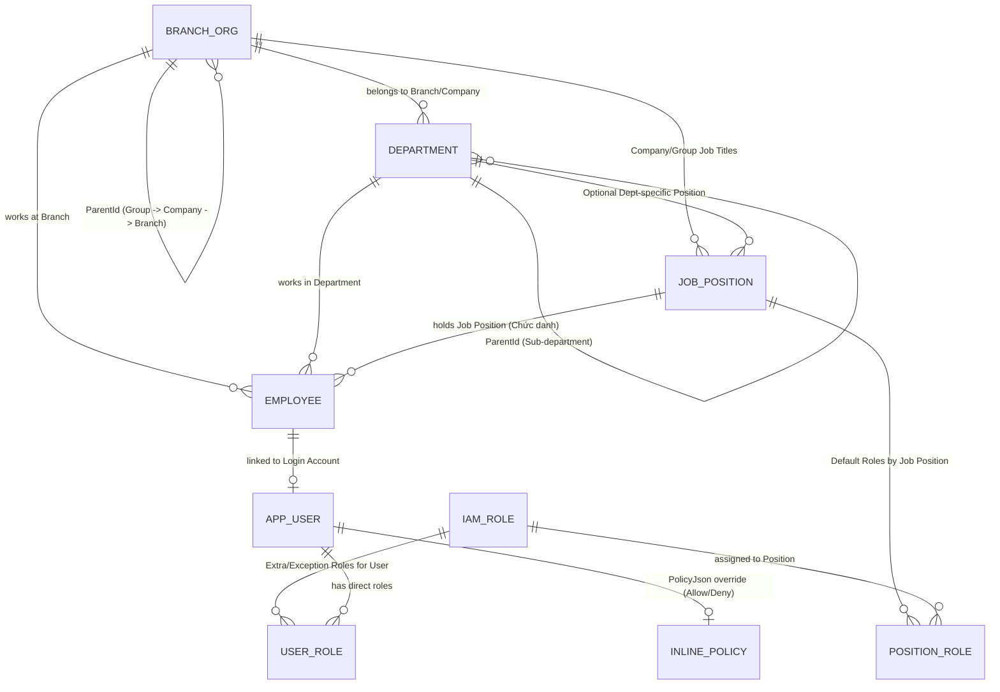

# 📋 KẾ HOẠCH PHÁT TRIỂN PHASE TIẾP THEO (STEP 20): TỔ CHỨC ĐA CẤP, CHỨC DANH & PHÂN QUYỀN ĐỘNG KIỂU AWS IAM (DYNAMIC JSON POLICY)

> **Ngày lập:** 2026-10-30  
> **Mã kế hoạch:** PLAN-STEP-20  
> **Phân hệ liên quan:** `SYS` (Hệ thống & IAM), `HRM` (Tổ chức, Phòng ban, Chức danh, Nhân sự), cùng toàn bộ 10 Submodules nghiệp vụ  
> **Đối tượng đọc:** Đội ngũ Developers (Backend .NET 10 & Frontend Angular + Ionic)  
> **Trạng thái:** BE xong (20.1, 20.2, 20.3, 20.5.1 — nhánh `thien/step-20-iam`, xem [step log](../steps/step-20-iam-dynamic-role-and-organization.md)); FE 20.4 chưa làm

---

## 🎯 1. BỐI CẢNH & MỤC TIÊU NGHIỆP VỤ

Hệ thống **ERPm** phục vụ mô hình **Tập đoàn (Group) -> Nhiều Công ty thành viên (Companies) -> Nhiều Chi nhánh (Branches) -> Nhiều Phòng ban (Departments) -> Nhiều Chức danh (Job Positions) -> Nhiều Nhân viên (Employees)**.

Yêu cầu cốt lõi cho giai đoạn phát triển này:
1. **Thiết lập Role động theo từng Công ty:** Mỗi công ty trong tập đoàn có thể tự định nghĩa các Role riêng (ví dụ: *Kế toán bán hàng*, *Kế toán kho*, *Trưởng vùng kinh doanh*) ngoài các Role mẫu của Tập đoàn.
2. **Phân quyền theo Chức danh (Position-Based - 90%) kết hợp Phân quyền ngoại lệ theo User (User-Override - 10%):**
   - Nhân viên được gắn **Chức danh (`JobPosition`)** sẽ tự động kế thừa toàn bộ `IAM Role` của chức danh đó mà không cần cấu hình tay từng tài khoản.
   - Hỗ trợ gán thêm Role kiêm nhiệm hoặc `InlinePolicyJson` (Allow thêm / Deny bớt) cho từng cá nhân cụ thể.
3. **Cấu trúc phân quyền động bằng JSON như AWS IAM kết hợp Data Scope:**
   - Hỗ trợ cấp quyền chi tiết theo từng trang/nghiệp vụ (`sd:order:view`, `sd:order:edit`, `sd:invoice:post`...) kèm Wildcard (`*`, `sd:*`, `*:view`) và nguyên tắc **`Explicit Deny` luôn thắng `Allow`**.
   - Hỗ trợ **Data Scope động**: Nhân viên thuộc chi nhánh nào mặc định chỉ xem/thao tác dữ liệu từ chi nhánh đó trở xuống (`BRANCH_TREE`), hoặc được cấu hình xem dữ liệu phòng ban (`DEPARTMENT`), cá nhân (`SELF`), các chi nhánh chỉ định (`CUSTOM_BRANCHES` / `CanViewBranchData`), hoặc toàn công ty (`COMPANY`).

---

## 🔍 2. KHẢO SÁT HIỆN TRẠNG MÃ NGUỒN (AS-IS BASELINE — STEP 19)

### 2.1. Nền tảng sẵn có cần kế thừa
1. **Cây phân cấp đơn vị (`tbl_SYS_Branch`):**
   - [`Branch.cs`](../../ERPm-BE/src/ERPm.Domain/Entities/System/Branch.cs) đã có quan hệ đệ quy `ParentId` -> `Id`.
   - [`BranchService.cs`](../../ERPm-BE/src/ERPm.Infrastructure/Services/BranchService.cs) và [`AccountValidationMiddleware.cs`](../../ERPm-BE/src/ERPm.API/Security/AccountValidationMiddleware.cs) đã có thuật toán duyệt cây lấy danh sách nhánh con (`Descendants`).
   - [`ApplicationDbContext.cs`](../../ERPm-BE/src/ERPm.Infrastructure/Persistence/ApplicationDbContext.cs) đã có Global Query Filter lọc theo `AllowedBranchIds` cho các bảng chứng từ.
2. **Hạ tầng PostgreSQL JSONB:**
   - Đã áp dụng thành công `jsonb` + `ValueComparer` + `GIN Index` cho `Item.Attributes` và `Translations`.

### 2.2. Các giới hạn hiện tại cần thay thế
1. **Role đang fix cứng 3 giá trị:** [`AppUser.Role`](../../ERPm-BE/src/ERPm.Domain/Entities/System/AppUser.cs) và [`AccountService.cs`](../../ERPm-BE/src/ERPm.API/Security/AccountService.cs) chỉ cho phép `"Admin" | "Operator" | "Viewer"`.
2. **Controller khóa cứng quyền Admin:** [`BaseCrudController.cs`](../../ERPm-BE/src/ERPm.API/Controllers/Base/BaseCrudController.cs) đang gắn cứng `[Authorize(Policy = "Admin")]` trên `POST / PUT / DELETE` và [`WriteAccessFilter.cs`](../../ERPm-BE/src/ERPm.API/Security/WriteAccessFilter.cs) chỉ kiểm tra policy `"Write"` chung chung.
3. **Thiếu thực thể Phòng ban, Chức danh, Nhân viên:** Chưa có `tbl_HRM_Department`, `tbl_HRM_JobPosition`, `tbl_HRM_Employee`.

---

## 🏗️ 3. KIẾN TRÚC MỤC TIÊU (TO-BE ARCHITECTURE)

### 3.1. Sơ đồ Thực thể Tổ chức, Chức danh & IAM (ER Diagram)



### 3.2. Thiết kế Chi tiết các Bảng CSDL (`SYS` & `HRM`)

> **Quy tắc bắt buộc:** Mọi bảng mới đều phải kế thừa `BaseAuditableEntity` hoặc `BaseEntity` theo chuẩn **Dual-Key Architecture** (`int Id` IDENTITY PK + `Guid ExternalId` UUIDv7 Unique Covering Index).

#### 1. Mở rộng `tbl_SYS_Branch` (Cây Tập đoàn -> Công ty -> Chi nhánh)
- Bổ sung `OrgUnitType` (`enum`):
  - `0 = Group` (Tập đoàn - node gốc `'root'`)
  - `1 = Company` (Công ty thành viên thuộc Tập đoàn, có Mã số thuế `TaxCode`, pháp nhân độc lập)
  - `2 = Branch` (Chi nhánh / Văn phòng / Cửa hàng trực thuộc Công ty hoặc Chi nhánh cấp trên)
- Bổ sung `CompanyId` (`int?`, FK -> `tbl_SYS_Branch.Id`): Trỏ về node Công ty chủ quản của chi nhánh đó để truy vấn phạm vi cấp Công ty tức thì.
- Bổ sung `TaxCode` (`varchar(50)`, nullable).

#### 2. Bảng Phòng ban (`tbl_HRM_Department`)
- `Code` (`varchar(50)`), `Name` (`varchar(200)`), `Translations` (`jsonb`).
- `CompanyId` (`int`, FK -> `tbl_SYS_Branch`), `BranchId` (`int`, FK -> `tbl_SYS_Branch`).
- `ParentId` (`int?`, FK tự tham chiếu `tbl_HRM_Department.Id`): Hỗ trợ Phòng ban -> Bộ phận / Tổ nhóm.
- `IsActive` (`bool`).

#### 3. Bảng Chức danh / Vị trí công việc (`tbl_HRM_JobPosition`)
- `Code` (`varchar(50)` - VD: `CHIEF_ACC`, `SALES_ACC`, `BRANCH_DIR`, `SALES_STAFF`), `Name` (`varchar(200)`), `Translations` (`jsonb`).
- `CompanyId` (`int?`, FK -> `tbl_SYS_Branch`): `null` nếu là Chức danh chuẩn cấp Tập đoàn; `!= null` nếu là Chức danh riêng của từng Công ty.
- `DepartmentId` (`int?`, FK -> `tbl_HRM_Department`): (Tùy chọn) Gắn với phòng ban chuyên môn.
- `RankOrder` (`int`): Cấp bậc chức danh (`1 = Giám đốc`, `2 = Trưởng phòng`, `3 = Trưởng nhóm`, `4 = Chuyên viên`, `5 = Nhân viên`).
- `DefaultScopeMode` (`varchar(30)`): Scope mặc định của chức danh (`SELF`, `DEPARTMENT`, `DEPARTMENT_TREE`, `BRANCH`, `BRANCH_TREE`, `COMPANY`).
- `IsActive` (`bool`).

#### 4. Bảng Nhân viên (`tbl_HRM_Employee`) & Tài khoản (`tbl_SYS_User`)
- **`tbl_HRM_Employee`**:
  - `Code` (`varchar(50)`), `FullName` (`varchar(255)`), `Email` (`varchar(100)`), `Phone` (`varchar(50)`).
  - `CompanyId` (`int`, FK -> `tbl_SYS_Branch`), `BranchId` (`int`, FK -> `tbl_SYS_Branch`), `DepartmentId` (`int?`, FK -> `tbl_HRM_Department`).
  - `JobPositionId` (`int`, FK -> `tbl_HRM_JobPosition`): Chức danh chính của nhân viên.
  - `UserId` (`int?`, Unique FK -> `tbl_SYS_User`): Liên kết 1-1 với tài khoản đăng nhập.
  - `IsActive` (`bool`).
- **Nâng cấp `tbl_SYS_User` (`AppUser`)**:
  - Bổ sung `EmployeeId` (`int?`), `CompanyId` (`int?`), `PrimaryBranchId` (`int?`), `DepartmentId` (`int?`), `JobPositionId` (`int?`).
  - Bổ sung `IsSuperAdmin` (`bool`): Dành cho quản trị viên tối cao cấp Tập đoàn.
  - Bổ sung `InlinePolicyJson` (`jsonb`, nullable): Lưu chính sách JSON đặc cách riêng cho User (Allow thêm hoặc Deny bớt).

#### 5. Bảng Role Động (`tbl_SYS_Role`) & Các bảng Gán Role
- **`tbl_SYS_Role`**:
  - `Code` (`varchar(50)`), `Name` (`varchar(200)`), `Description` (`varchar(500)`), `Translations` (`jsonb`).
  - `CompanyId` (`int?`, FK -> `tbl_SYS_Branch`):
    - `null`: Role mẫu toàn Tập đoàn.
    - `!= null`: Role động do **Công ty tự tạo và tự quản lý**.
  - `IsSystemRole` (`bool`): Chống xóa nhầm các Role mặc định.
  - `PolicyDocument` (`jsonb`): Lưu tài liệu JSON phân quyền theo chuẩn AWS IAM.
  - `IsActive` (`bool`).
- **`tbl_SYS_JobPositionRole`** *(Phân quyền theo Chức danh - Luồng chính 90%)*:
  - `JobPositionId` (`int`, FK -> `tbl_HRM_JobPosition`), `RoleId` (`int`, FK -> `tbl_SYS_Role`).
- **`tbl_SYS_UserRole`** *(Phân quyền bổ sung/kiêm nhiệm cho User - Luồng phụ 10%)*:
  - `UserId` (`int`, FK -> `tbl_SYS_User`), `RoleId` (`int`, FK -> `tbl_SYS_Role`).
  - `ScopeOverrideJson` (`jsonb`, nullable): Cho phép mở rộng phạm vi chi nhánh cụ thể (`CustomBranchIds`) khi nhân viên kiêm nhiệm nhiều chi nhánh.

---

## 📜 4. ĐẶC TẢ CHUẨN JSON POLICY KIỂU AWS IAM CHO ERPM

### 4.1. Cấu trúc JSON (`PolicyDocument`)

```json
{
  "Version": "2026-10",
  "Statements": [
    {
      "Sid": "AccountantOrderAndInvoiceAccess",
      "Effect": "Allow",
      "Actions": [
        "sd:order:view",
        "sd:order:edit",
        "sd:invoice:view",
        "sd:invoice:create",
        "sd:invoice:post"
      ],
      "Resources": ["*"],
      "DataScope": {
        "Mode": "BRANCH_TREE",
        "IncludeDescendants": true,
        "CustomBranchIds": [],
        "CustomDepartmentIds": []
      }
    },
    {
      "Sid": "AllowViewCrossBranchStock",
      "Effect": "Allow",
      "Actions": [
        "wms:stock:view"
      ],
      "Resources": ["*"],
      "DataScope": {
        "Mode": "CUSTOM_BRANCHES",
        "IncludeDescendants": true,
        "CustomBranchIds": [2, 5]
      }
    },
    {
      "Sid": "DenyDeleteOrCancelInvoice",
      "Effect": "Deny",
      "Actions": [
        "sd:invoice:cancel",
        "sd:order:delete"
      ],
      "Resources": ["*"]
    }
  ]
}
```

### 4.2. Các chế độ `DataScope.Mode`
Khi một câu lệnh `Allow` được kích hoạt, Backend sẽ dịch `DataScope.Mode` thành điều kiện lọc SQL (`WHERE`) dựa trên thông tin tổ chức của nhân viên đang đăng nhập:

| Mã `Mode` | Ý nghĩa nghiệp vụ | Điều kiện lọc dữ liệu tương ứng ở Backend |
| :--- | :--- | :--- |
| `SELF` | Chỉ dữ liệu cá nhân | `CreatedBy == CurrentUser.UserId` |
| `DEPARTMENT` | Trong phòng ban của nhân viên | `DepartmentId == CurrentUser.DepartmentId` |
| `DEPARTMENT_TREE` | Phòng ban hiện tại và các tổ/nhóm con | `DepartmentId IN Descendants(CurrentUser.DepartmentId)` |
| `BRANCH` | Chỉ đúng chi nhánh đang làm việc | `BranchId == CurrentUser.PrimaryBranchId` |
| `BRANCH_TREE` | **Từ chi nhánh của nhân viên trở xuống** | `BranchId IN Descendants(CurrentUser.PrimaryBranchId)` |
| `CUSTOM_BRANCHES` | **Can View Branch Data** (Chọn các chi nhánh cụ thể) | `BranchId IN CustomBranchIds` (kèm nhánh con nếu `IncludeDescendants = true`) |
| `COMPANY` | Toàn bộ các chi nhánh thuộc Công ty | `BranchId IN AllBranchesOf(CurrentUser.CompanyId)` |
| `GROUP` | Toàn Tập đoàn | Không giới hạn `BranchId` (chỉ dành cho Role cấp Tập đoàn) |

### 4.3. Nguyên tắc hợp nhất quyền (Policy Evaluation Rules)
1. **Default Deny:** Mặc định không có quyền nếu không khớp bất kỳ `Statement` nào có `Effect = "Allow"`.
2. **Nguồn tập hợp Policy của 1 User:**
   $$\text{Statements} = \text{Statements(JobPosition Roles)} \cup \text{Statements(User Extra Roles)} \cup \text{Statements(User InlinePolicyJson)}$$
3. **Explicit Deny Wins:** Nếu có bất kỳ `Statement` nào khớp `Action` mang `Effect = "Deny"` -> Từ chối ngay lập tức (`403 Forbidden`).
4. **Union DataScope:** Nếu nhiều `Statement` cùng `Allow` một `Action` với các `DataScope` khác nhau (ví dụ: Chức danh cho xem `BRANCH_TREE` tại Chi nhánh A, nhưng User được gán thêm `CustomBranchIds: [Chi nhánh B]`), phạm vi dữ liệu thực tế sẽ là **tập hợp (Union)** của cả Chi nhánh A (cùng nhánh con) và Chi nhánh B.

---

## 🛠️ 5. PHÂN RÃ CÔNG VIỆC TRIỂN KHAI (WORK BREAKDOWN CHO TEAM)

### Phase 20.1: Database Schema, Entities & Seed Data (Backend)
- [x] **Task 20.1.1:** Cập nhật `Branch.cs` bổ sung `OrgUnitType`, `CompanyId`, `TaxCode`.
- [x] **Task 20.1.2:** Tạo các Entity mới trong `ERPm.Domain`:
  - `Entities/HRM/Department.cs` (`tbl_HRM_Department`)
  - `Entities/HRM/JobPosition.cs` (`tbl_HRM_JobPosition`)
  - `Entities/HRM/Employee.cs` (`tbl_HRM_Employee`)
  - `Entities/System/IamRole.cs` (`tbl_SYS_Role`) + Value Object `IamPolicyDocument`
  - `Entities/System/JobPositionRole.cs` (`tbl_SYS_JobPositionRole`)
  - `Entities/System/UserRole.cs` (`tbl_SYS_UserRole`)
- [x] **Task 20.1.3:** Bổ sung `DepartmentId` (nullable) vào các chứng từ (`SalesOrder`, `SalesInvoice`, `PurchaseOrder`, `StockReceipt`, `StockIssue`).
- [x] **Task 20.1.4:** Cấu hình Fluent API trong `ApplicationDbContext.cs`, tạo EF Core Migration và cập nhật `EssentialDataSeeder.cs` với cây mẫu (Tập đoàn -> Công ty -> Chi nhánh -> Phòng ban -> Chức danh -> Role mẫu).

### Phase 20.2: IAM Policy Engine & Security Middleware (Backend)
- [x] **Task 20.2.1:** Xây dựng `PermissionCatalog` định nghĩa toàn bộ mã `module:resource:action` của hệ thống.
- [x] **Task 20.2.2:** Xây dựng `IamPolicyEvaluator` hỗ trợ so khớp Wildcard (`*`, `sd:*`, `*:view`), kiểm tra `Deny` trước `Allow`, và tính toán `EffectiveDataScope` (`AllowedBranchIds`, `AllowedDepartmentIds`, `OnlyOwnRecords`).
- [x] **Task 20.2.3:** Nâng cấp `ICurrentUser`, `CurrentUser` và `AccountValidationMiddleware`:
  - Tính toán và cache quyền hiệu lực theo `UserId + SecurityStamp`.
  - Đồng bộ với Global Query Filters của `ApplicationDbContext`.
- [x] **Task 20.2.4:** Tạo `[RequirePermission("...")]` Attribute và cập nhật `BaseCrudController` cùng các Controller nghiệp vụ để kiểm tra đúng quyền từng phân hệ thay vì khóa cứng `Policy = "Admin"`.

### Phase 20.3: API Quản trị Tổ chức, Chức danh & Role Động (Backend)
- [x] **Task 20.3.1:** Xây dựng CRUD API cho `DepartmentsController`, `JobPositionsController`, `EmployeesController`.
- [x] **Task 20.3.2:** Xây dựng `RolesController` (`/api/v1/sys/roles`) và `/api/v1/sys/permissions/catalog`:
  - Cho phép Công ty tự tạo/sửa Role động của công ty mình.
  - Gán Role vào Chức danh (`JobPosition`) và gán Role/Inline Policy vào `User`.
  - Áp dụng **Privilege Escalation Guard**: Người tạo Role không được cấp những Action hoặc Branch nằm ngoài quyền hạn của chính người đó.

### Phase 20.4: Giao diện Quản trị Tổ chức & Thiết kế Role Động (Frontend)
- [ ] **Task 20.4.1:** Nâng cấp `AuthService` (`ERPm-FE/src/app/core/services/auth.service.ts`) nhận danh sách quyền hiệu lực và scope từ `/api/v1/auth/me`; cung cấp hàm `can(action)` và `permissionGuard`.
- [ ] **Task 20.4.2:** Xây dựng các màn hình quản trị trong module `HRM` / `SYS` (tuân thủ `FormGroup` + `<app-form-control>` / `<app-input-control>`):
  - Quản lý Cây Tổ chức (Tập đoàn – Công ty – Chi nhánh – Phòng ban).
  - Quản lý Danh mục Chức danh (`JobPosition`) & Gán Role mặc định cho Chức danh.
  - Quản lý Hồ sơ Nhân viên (`Employee`) & Cấp tài khoản đăng nhập.
- [ ] **Task 20.4.3:** Xây dựng màn hình **Thiết kế Role Động (Dynamic Role & IAM Policy Builder)** hỗ trợ 2 chế độ đồng bộ 2 chiều:
  - **Tab 1 - Ma trận trực quan (Visual Matrix):** Tick chọn quyền `Xem / Thêm / Sửa / Xóa / Duyệt / Hủy` theo từng trang và chọn `DataScope` (`Từ chi nhánh hiện tại trở xuống`, `Chọn chi nhánh cụ thể`, `Phòng ban`, `Toàn công ty`...).
  - **Tab 2 - Trình soạn thảo JSON (AWS IAM JSON Editor):** Chỉnh sửa trực tiếp cấu trúc JSON `Statements` dành cho Admin nâng cao.
- [ ] **Task 20.4.4:** Cập nhật từ điển song ngữ VI/EN (`system_dictionary.json`) cho toàn bộ nhãn giao diện và thông báo lỗi phân quyền.

### Phase 20.5: Kiểm thử Tự động (Verification) & Nghiệm thu
- [x] **Task 20.5.1:** Bổ sung bộ test tích hợp PostgreSQL vào `tests/ERPm.Verification`:
  - Test kế thừa quyền tự động từ `JobPosition` xuống `Employee/User`.
  - Test `BRANCH_TREE` (chỉ xem được dữ liệu từ chi nhánh của mình trở xuống) và `CUSTOM_BRANCHES` (`CanViewBranchData`).
  - Test `Explicit Deny` ghi đè `Allow` và chống leo thang đặc quyền giữa các Công ty trong Tập đoàn.
- [ ] **Task 20.5.2:** Chạy `dotnet build` (0 warning, 0 error), `npm run build` (0 error), ghi log `.ai/steps/step-20-iam-dynamic-role-and-organization.md` và cập nhật `.ai/status.md`.

---

## 🔄 5b. THAY ĐỔI YÊU CẦU

### CR-20-01 (2026-10-31): Gán role theo phòng ban, gán nhân sự khi tạo user
- **Người yêu cầu:** Thiện (tổng hợp yêu cầu nhóm, chờ Phúc chốt) · **Ngày:** 2026-10-31
- **Yêu cầu mới (4 nhóm):**
  1. **ROLE:** gán role theo **phòng ban** và theo **user**.
  2. **BRANCH:** tạo tập đoàn / công ty / chi nhánh, tạo **bộ phận, phòng ban**.
  3. **USER:** tạo user và **gán nhân sự** ngay lúc tạo.
  4. **HRM:** tạo nhân sự.
- **Đối chiếu với bản đã làm (BE trên master):**

  | Nhóm | Đã có | Thiếu |
  | :--- | :--- | :--- |
  | ROLE theo user | `PUT /api/v1/sys/roles/users/{id}` | Màn FE |
  | ROLE theo phòng ban | Chỉ gán được cho chức danh (`JobPositionRole`) | Bảng `DepartmentRole`, engine, API (20.6.1–20.6.3) |
  | BRANCH | `/api/v1/branches` (`orgUnitType`, `taxCode`, `/tree`), `/api/v1/hrm/departments` (có `ParentId`) | Màn FE |
  | USER gán nhân sự | Chỉ gán từ phía nhân viên (`Employee.UserId`) | `employeeId` trong request user (20.6.4) |
  | HRM tạo nhân sự | `/api/v1/hrm/employees`, `/hrm/work-histories` | Màn FE |

- **Lý do:** quản trị thường cấp quyền theo phòng ban (cả phòng có chung quyền). Chỉ gán theo chức danh thì phải tạo chức danh riêng cho mỗi phòng.
- **Thiết kế "bộ phận" / "phòng ban" (đã so sánh, chọn phương án C):**

  | Phương án | Mô tả | Ưu | Nhược |
  | :--- | :--- | :--- | :--- |
  | A. Tách bảng | `tbl_HRM_Department` + bảng riêng `tbl_HRM_Section` (bộ phận), sau này thêm Tổ / Nhóm | Rõ từng cấp | Cố định số cấp; nhân viên, chức danh, chứng từ phải có nhiều FK; engine phạm vi phải duyệt nhiều cây; mỗi cấp một bộ CRUD |
  | B. Một cây, không có cấp | Bảng hiện tại, chỉ dùng `ParentId` | Đơn giản, không đổi gì | Không phân biệt được Phòng với Bộ phận; không chặn được cây sai (Phòng nằm dưới Bộ phận); báo cáo theo cấp khó |
  | **C. Một cây + danh mục cấp (chọn)** | Giữ `tbl_HRM_Department` (`ParentId`), thêm danh mục `tbl_HRM_DepartmentLevel`; `Department.LevelId` | Số cấp do từng công ty tự khai báo (Khối / Phòng / Bộ phận / Tổ…), đa ngôn ngữ; mọi FK vẫn là một `DepartmentId`; engine `OrgTree` và `DEPARTMENT_TREE` hiện tại dùng lại nguyên | Thêm 1 bảng danh mục, thêm 1 quy tắc kiểm tra khi lưu |

  - `tbl_HRM_DepartmentLevel`: `Code`, `Name`, `Translations` (JSONB), `SortOrder` (cấp càng sâu thì số càng lớn), `CompanyId` (null = dùng chung cả tập đoàn), `IsActive`. Seed mặc định: `DIVISION` Khối (10), `DEPARTMENT` Phòng (20), `SECTION` Bộ phận (30), `TEAM` Tổ (40).
  - Quy tắc khi lưu phòng ban:
    - `SortOrder` của cấp con phải **lớn hơn** của cấp cha (`error.hrm.department_level_order`);
    - con phải cùng `CompanyId` với cha;
    - không được tạo vòng lặp (đã có).
  - Thêm `Path` (`/1/5/12/`) và `Depth` tính tự động khi lưu hoặc khi đổi cha (cập nhật cả nhánh con). Hai cột này để báo cáo và lọc "phòng X và các cấp dưới" chạy thẳng trong SQL (`path LIKE '/1/5/%'`), không phải đệ quy. Index `path` dùng `text_pattern_ops`.
  - Dữ liệu cũ: phòng ban đã có thì gán `LevelId` = `DEPARTMENT`, và tính `Path` trong migration.
- **Quy tắc quyền hiệu lực (sau CR):** hợp các nguồn sau, `Deny` tường minh vẫn thắng:
  1. role gán thẳng cho user;
  2. role của chức danh;
  3. role của phòng ban hiện tại (theo QTCT / `Employee.DepartmentId`);
  4. role của phòng ban cha có `ApplyToChildren = true`.
- **Phạm vi:** chỉ thêm. Không đổi `JobPositionRole`/`UserRole` và không đổi API cũ. Thêm 1 migration.

### Phase 20.6: Triển khai CR-20-01

> **Ưu tiên:** dựng lõi 4 nhóm ROLE / BRANCH / USER / HRM trước để anh em dùng ngay. Các trường hợp mở rộng (M1–M3) xem mục "Mở rộng sau".
> Mỗi task ghi: người làm, phụ thuộc, việc phải làm, cách nghiệm thu. Xong thì tick `- [x]` và ghi commit.

**Backend (không bị chặn, làm được ngay)**

- [ ] **Task 20.6.0 [db] Danh mục cấp phòng ban + `Path`.** Người làm: _(giao)_ · Phụ thuộc: không
  - Entity `Entities/HumanResource/DepartmentLevel.cs` (`tbl_HRM_DepartmentLevel`) và thêm `LevelId` (FK restrict), `Path`, `Depth` vào `Department`.
  - Thêm sẵn các cột móc cho mở rộng, chỉ thêm cột, chưa có logic:
    - `StandardLevelCode` (nullable) trong danh mục cấp, dùng cho M1;
    - `EffectiveFrom` / `EffectiveTo` (nullable) trong `Department`, dùng cho M2.
  - Migration `AddDepartmentLevel`: seed 4 cấp mặc định; phòng ban cũ được `LevelId = DEPARTMENT` và tính `Path`/`Depth` bằng SQL đệ quy.
  - CRUD `/api/v1/hrm/department-levels` (quyền `hrm:department:view/edit`). Không xóa được cấp đang dùng (`error.validation.reference`).
  - `DepartmentService`:
    - kiểm tra thứ tự cấp và cùng công ty;
    - tính `Path`/`Depth`, khi đổi cha thì cập nhật `Path` của cả nhánh con trong cùng transaction;
    - gọi `Invalidate()` của IAM khi đổi cha.
  - `GET /api/v1/hrm/departments?levelCode=SECTION` và `?underId={id}` (lọc theo `Path`).
  - **Nghiệm thu:** tạo được Khối → Phòng → Bộ phận → Tổ; tạo Phòng dưới Bộ phận bị chặn; chuyển một Phòng sang Khối khác thì `Path` của các Bộ phận con đổi theo.
- [ ] **Task 20.6.1 [db] Bảng `tbl_SYS_DepartmentRole`.** Người làm: _(giao)_ · Phụ thuộc: không
  - Entity `Entities/System/DepartmentRole.cs`: `DepartmentId`, `RoleId`, `ApplyToChildren` (bool, mặc định `false`). Dùng dual-key và auditable như `JobPositionRole`.
  - Unique `(department_id, role_id)`; FK tới `tbl_HRM_Department` và `tbl_SYS_Role` (restrict).
  - Migration `AddDepartmentRole` (chỉ thêm), chạy lại `tools/ERPm.Schema` → `database/current_model.sql`.
  - Seed mẫu: 1 role gán cho một phòng ban trong `OrganizationSampleSeeder`.
  - **Nghiệm thu:** `dotnet ef database update` trên DB sạch thành công; `current_model.sql` có bảng mới.
- [ ] **Task 20.6.2 IAM engine nhận role của phòng ban.** Người làm: _(giao)_ · Phụ thuộc: 20.6.1
  - Gom việc lấy role của chức danh và phòng ban vào một hàm nhận **danh sách vị trí** `(DepartmentId, JobPositionId)`; hiện truyền 1 vị trí chính, làm móc cho kiêm nhiệm M3.
  - `IamService`: khi tính quyền hiệu lực, thêm role của `Employee.DepartmentId` và của các phòng ban cha có `ApplyToChildren`.
  - Gọi `Invalidate()` khi:
    - gán hoặc gỡ role của phòng ban;
    - đổi `DepartmentId` của nhân viên (tạo hoặc sửa QTCT);
    - đổi `ParentId` của phòng ban.
  - **Nghiệm thu:** test ở 20.6.5; `/api/v1/auth/me` trả `permissions[]` có quyền lấy từ phòng ban.
- [ ] **Task 20.6.3 API gán role cho phòng ban.** Người làm: _(giao)_ · Phụ thuộc: 20.6.1
  - Endpoint:
    - `GET /api/v1/sys/roles/departments/{departmentId}`: quyền `sys:role:view`;
    - `PUT /api/v1/sys/roles/departments/{departmentId}`: quyền `sys:role:edit`, body `[{ roleId, applyToChildren }]`.
  - Áp guard leo thang quyền (`error.iam.escalation`) và giới hạn công ty (`error.iam.company_scope`): phòng ban và role phải cùng công ty với người gán, trừ super admin.
  - Logic nằm trong `RoleService`, controller chỉ gọi service.
  - **Nghiệm thu:** gán được role cho phòng ban cùng công ty; gán sang công ty khác bị 403.
- [ ] **Task 20.6.4 Gán nhân sự khi tạo / sửa user.** Người làm: _(giao)_ · Phụ thuộc: không
  - Thêm `employeeId?` vào `UserRequest` và `UserAccessRequest`. `AccountDto` trả thêm `employeeId`, `employeeCode`, `employeeName`.
  - Kiểm tra:
    - nhân viên tồn tại và cùng công ty với người tạo;
    - nhân viên chưa có tài khoản, nếu có rồi thì trả `error.hrm.user_linked`;
    - gửi `employeeId = null` khi sửa thì gỡ liên kết.
  - Ghi vào `Employee.UserId` (giữ một nguồn liên kết duy nhất, không thêm cột ở `AppUser`).
  - `GET /api/v1/hrm/employees?withoutAccount=true` để FE lọc nhân viên chưa có tài khoản.
  - **Đã chốt (Thiện, 2026-10-31): bắt buộc gán nhân sự** khi admin cấp công ty tạo user; chỉ super admin được tạo user không gắn nhân sự (tài khoản hệ thống). Lý do — lỗi đang có: `GET /auth/users` lọc theo nhân viên của công ty. Vì vậy admin công ty tạo user mà chưa gán nhân sự thì sẽ không thấy user vừa tạo. Thiếu `employeeId` thì trả `error.validation.required`.
  - **Nghiệm thu:** tạo user kèm nhân sự thì `/auth/me` trả đúng `employeeId`, `companyId`, `departmentId`.
- [ ] **Task 20.6.5 Test và từ điển.** Người làm: _(giao)_ · Phụ thuộc: 20.6.0–20.6.4
  - Thêm khoảng 9 check vào `tests/ERPm.Verification`:
    - cấp con phải sâu hơn cấp cha (chặn Phòng dưới Bộ phận);
    - đổi cha thì `Path` của cả nhánh con cập nhật theo;
    - admin công ty tạo user thiếu `employeeId` bị chặn;
    - role của phòng ban được cấp cho nhân viên;
    - `ApplyToChildren` đi xuống phòng ban con, còn khi `false` thì không;
    - điều chuyển phòng ban thì mất quyền cũ;
    - `Deny` ở role user thắng `Allow` của phòng ban;
    - gán role cho phòng ban của công ty khác bị 403;
    - tạo user với nhân viên đã có tài khoản bị chặn.
  - Thêm nhãn và mã lỗi mới vào `app_dictionaries` (VI/EN).
  - **Nghiệm thu:** `dotnet build` 0 cảnh báo 0 lỗi; `ERPm.Verification` đạt hết (93 + check mới); `ERPm.Hrm.Verification` 28.

**Frontend (bị chặn bởi [bug con trỏ submodule SD/CRM](../tasks/bug-20261031-fe-submodule-pointers-unpushed.md))**

- [ ] **Task 20.6.6 Bổ sung vào màn 20.4.2.** Người làm: _(giao)_ · Phụ thuộc: 20.4.1, 20.6.3, 20.6.4
  - Màn cây tổ chức: chọn node phòng ban thì có tab **Role** (danh sách role, ô "áp dụng cho phòng ban con").
  - Màn user: ô chọn **Nhân sự** (lọc `withoutAccount=true`), hiện mã và tên nhân viên trên lưới.
  - Màn nhân viên: nút **Cấp tài khoản**, mở form user với nhân sự đã chọn sẵn.
  - Dùng `FormGroup` + `<app-form-control>`/`<app-input-control>`; ẩn nút theo `can('sys:role:edit')`, `can('sys:user:create')`.
  - **Nghiệm thu:** `npm run build` 0 lỗi; thao tác được trên `http://localhost:4200` với tài khoản admin công ty mẫu.

**Gợi ý chia việc:** 20.6.0–20.6.5 một người BE làm liền mạch (khoảng 1,5–2 ngày). 20.4.x và 20.6.6 cho người FE sau khi gỡ bug submodule.

### Mở rộng sau (ghi nhận 2026-10-31, KHÔNG làm trong CR-20-01)

> CR-20-01 chỉ dựng **lõi** của 4 nhóm ROLE / BRANCH / USER / HRM để anh em làm tiếp các module khác. Những mục dưới đây đã có điểm móc sẵn (cột hoặc quy tắc), sau này mở rộng thì **chỉ thêm, không sửa** phần lõi.

| # | Trường hợp | Ví dụ | Hướng làm | Điểm móc dựng sẵn ở 20.6.0 |
| :--- | :--- | :--- | :--- | :--- |
| M1 | Báo cáo gộp tập đoàn khi mỗi công ty đặt tên cấp khác nhau | "Nhóm" của công ty B tương ứng "Tổ" của công ty A | Ánh xạ cấp riêng về cấp chuẩn của tập đoàn; báo cáo gộp theo cấp chuẩn | Cột `StandardLevelCode` (nullable) trong `tbl_HRM_DepartmentLevel` |
| M2 | **Tái cơ cấu theo thời gian** (gộp / tách / đổi cha) | 01/2027 nhập Phòng A vào Khối X | Đã có QTCT thì không sửa `ParentId` tại chỗ: tạo node mới, đóng node cũ (`EffectiveTo`), điều chuyển nhân viên qua QTCT. Thêm `tbl_HRM_DepartmentHistory` (bản cũ + ngày hiệu lực), API `/hrm/departments/tree?asOf=`. QTCT lưu thêm `DepartmentPath` tại thời điểm hiệu lực để báo cáo kỳ cũ không đổi | Cột `EffectiveFrom`, `EffectiveTo` (nullable) trong `tbl_HRM_Department`; `Path` đã có |
| M3 | **Kiêm nhiệm** | Một người vừa ở Phòng KT vừa ở Ban kiểm soát | Bảng `tbl_HRM_ConcurrentAssignment` (nhân viên, phòng ban, chức danh, từ ngày, đến ngày). IAM cộng thêm role và phạm vi của vị trí kiêm nhiệm còn hiệu lực | Ở 20.6.2, viết hàm lấy role theo **danh sách vị trí** (`IEnumerable<(DepartmentId, JobPositionId)>`, hiện chỉ có vị trí chính), nên M3 chỉ cần thêm nguồn |

- Đã xử lý sẵn trong lõi, không cần mở rộng:
  - mỗi công ty có bộ cấp riêng (`CompanyId` trong danh mục cấp);
  - độ sâu tùy ý;
  - bỏ qua cấp giữa (chỉ cần cấp con sâu hơn cấp cha);
  - mỗi chi nhánh một cây (`BranchId`).

## ⏳ 6. VIỆC CÒN LẠI (cập nhật 2026-10-31)

| Task | Trạng thái | Ghi chú |
| :--- | :--- | :--- |
| 20.4.1 `AuthService.can()` + `permissionGuard` | Chưa làm | BE đã có: `/api/v1/auth/me` trả `permissions[]`, `readScope`, `companyId`, `primaryBranchId`, `departmentId`, `jobPositionId`. FE thay kiểm tra `role === 'Admin'` bằng `can(action)`. |
| 20.4.2 Màn cây tổ chức, chức danh + gán role, nhân viên + cấp tài khoản | Chưa làm | API: `/api/v1/branches` (thêm `orgUnitType`, `taxCode`), `/api/v1/hrm/{departments,job-positions,employees,work-histories}`, `/api/v1/sys/roles/job-positions/{id}`, `/api/v1/auth/users` (role `None` cho tài khoản chỉ dùng role động). |
| 20.4.3 Role designer (ma trận + JSON editor) | Chưa làm | API: `/api/v1/sys/roles`, `/api/v1/sys/permissions/catalog`, `/api/v1/sys/roles/users/{id}`. Lỗi 403 `error.iam.escalation` / `error.iam.company_scope` cần hiển thị rõ. |
| 20.4.4 Từ điển VI/EN | Một phần | BE đã thêm `error.iam.*`, `error.hrm.user_linked`; còn nhãn giao diện các màn mới. |
| 20.5.2 Build & log | Một phần | `dotnet build` 0/0, 75 + 28 check đạt; còn `npm run build` sau khi làm FE. |
| Gán `DepartmentId` cho chứng từ | Chưa làm | Cột đã có (nullable) và đã dùng trong query filter, nhưng DTO/UI tạo chứng từ chưa nhận giá trị. |
| CR-20-01: 20.6.0–20.6.5 (BE cấp phòng ban + Path, role theo phòng ban, bắt buộc gán nhân sự khi tạo user) | Chưa làm | Không bị chặn. Chờ Phúc chốt CR-20-01. |
| CR-20-01: 20.6.6 (FE tab Role phòng ban, chọn nhân sự cho user) | Chưa làm | Bị chặn cùng 20.4. |
| Mở rộng M1–M3 (cấp chuẩn tập đoàn, tái cơ cấu theo thời gian, kiêm nhiệm) | Để sau | Xem mục "Mở rộng sau" trong 5b; cột móc làm sẵn ở 20.6.0. |
| Cache quyền đa instance | Để sau | Cache IAM đang in-process; khi chạy nhiều API instance cần chuyển version sang Redis/DB. |

**Chặn:** 20.4 và 20.6.6 chờ gỡ [bug con trỏ submodule SD/CRM](../tasks/bug-20261031-fe-submodule-pointers-unpushed.md) (FE master trỏ SD `52500c5`, CRM `9f4a4c6` chưa có trên GitHub).
