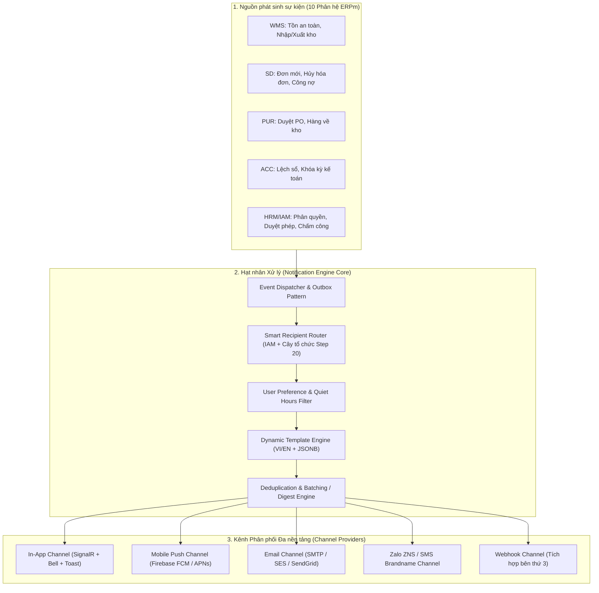

# 🏛️ ĐẶC TẢ KIẾN TRÚC & KẾ HOẠCH PHÁT TRIỂN NỀN TẢNG THÔNG BÁO TỔNG THỂ (STEP 21: ENTERPRISE NOTIFICATION ENGINE)

> **Mã kế hoạch:** `PLAN-STEP-21-ENTERPRISE-NOTIFICATION-ENGINE`  
> **Dự án:** ERPm — Phần mềm Quản trị Bán hàng, Tồn kho & Kế toán Hybrid  
> **Tầm nhìn:** Xây dựng **Notification Engine dùng chung cho toàn bộ 10 phân hệ ERP** (`SYS`, `WMS`, `SD`, `PUR`, `ACC`, `CRM`, `HRM`, `MFG`, `SCM`, `PM`) và mọi nền tảng (Web Desktop, Mobile App, Tablet).  
> **Khả năng mở rộng:** Hỗ trợ đa kênh (In-App, Push Mobile, Email, SMS/ZNS, Webhook), định tuyến thông minh theo IAM & Cây tổ chức, cấu hình nhận tin theo người dùng, gom tin (Digest/Batching), chống nghẽn, và sẵn sàng scale cụm (Redis Backplane).

---

## 🧭 1. TẦM NHÌN KIẾN TRÚC MỞ RỘNG (ENTERPRISE EXTENSIBILITY PRINCIPLES)

Để đáp ứng nhu cầu cho toàn bộ hệ thống ERPm từ hiện tại đến 5–10 năm tới, Notification System không được xây dựng như một tính năng cục bộ của một module, mà được chuẩn hóa thành một **Nền tảng Thông báo Tập trung (Enterprise Notification Engine - ENE)** với 7 trụ cột mở rộng bắt buộc:



### 7 Trụ cột Mở rộng Cốt lõi:
1. **Decoupled Event-Driven & Outbox Pattern:** Nghiệp vụ chính (bán hàng, xuất kho) phát sinh sự kiện mà **không bị block hoặc rollback nếu việc gửi thông báo gặp sự cố mạng**. Sử dụng Outbox Pattern để bảo toàn 100% tính nguyên tử.
2. **Channel Abstraction (Trừu tượng hóa Kênh):** Mọi kênh (`InApp`, `Email`, `PushMobile`, `SMS`, `Webhook`) đều hiện thực chung một interface `INotificationChannelProvider`. Thêm kênh mới trong tương lai chỉ cần implement provider mà không sửa đổi core engine.
3. **Smart Recipient Routing (Định tuyến thông minh theo Cây tổ chức & IAM Step 20):**
   - Hỗ trợ gửi theo `UserId` (Cá nhân).
   - Gửi theo `JobPositionId` (Chức danh: vd gửi cho tất cả Kế toán trưởng `CHIEF_ACC`).
   - Gửi theo `DepartmentId` (Phòng ban), `BranchId` (kèm `BRANCH_TREE`), `CompanyId` (Toàn công ty) hoặc `GROUP` (Toàn tập đoàn).
   - Gửi theo quyền hạn IAM (vd: gửi tới bất kỳ ai có quyền `sd:invoice:cancel`).
4. **User Preference Matrix (Cấu hình Nhận tin Cá nhân hóa):**
   - Người dùng được quyền cấu hình bật/tắt từng kênh nhận cho từng loại thông báo.
   - Hỗ trợ thiết lập "Giờ yên tĩnh (Quiet Hours)": Ban đêm không rung chuông/push di động, chỉ lưu hòm thư in-app.
5. **Batching, Digest & Deduplication (Gom tin & Chống bão thông báo):**
   - Khi có 50 mặt hàng cùng chạm ngưỡng tồn kho trong 1 phút kiểm kê, hệ thống tự động gom (digest) thành 1 thông báo: *"Có 50 mặt hàng sắp hết tồn kho"* thay vì bắn 50 thông báo làm treo máy người dùng.
6. **Multi-Language Dynamic Templates:**
   - Quản lý template tập trung trong CSDL với mã nhận diện (`TemplateCode`).
   - Hỗ trợ placeholder động `{customer_name}`, `{order_code}`, `{amount}` nạp qua PostgreSQL `JSONB`.
7. **Scale-Out Ready (Sẵn sàng Cụm máy chủ):**
   - Trừu tượng hóa bộ đệm thời gian thực với SignalR; khi hệ thống triển khai nhiều server API, chỉ cần cắm **Redis Backplane** mà không phải refactor lại mã nguồn.

---

## 🗄️ 2. THIẾT KẾ CƠ SỞ DỮ LIỆU MỞ RỘNG (POSTGRESQL - 5 BẢNG CHUẨN DOANH NGHIỆP)

Tất cả các bảng tuân thủ nghiêm ngặt **Dual-Key Architecture** (`int Id` PK IDENTITY + `Guid ExternalId` UUIDv7 Unique Covering Index) và Soft-delete của dự án.

### 2.1. Bảng 1: Danh mục Mẫu Thông báo (`tbl_SYS_NotificationTemplate`)
Quản lý các loại thông báo của toàn hệ thống, cấu hình kênh mặc định và nội dung mẫu song ngữ:
- `id` (`int` PK IDENTITY), `external_id` (`uuid` NOT NULL Covering Index).
- `code` (`varchar(100)` NOT NULL UNIQUE): Mã mẫu (vd: `WMS_LOW_STOCK`, `SD_ORDER_NEW`, `SD_INVOICE_CANCELLED`, `HRM_TIMESHEET_APPROVED`, `SYS_SECURITY_ALERT`).
- `name` (`varchar(200)` NOT NULL): Tên gợi nhớ của sự kiện.
- `category` (`varchar(50)` NOT NULL): Phân hệ (`WMS`, `SD`, `PUR`, `ACC`, `CRM`, `HRM`, `SYS`...).
- `default_severity` (`varchar(20)` NOT NULL DEFAULT `'INFO'`): `INFO`, `SUCCESS`, `WARNING`, `DANGER`.
- `supported_channels` (`varchar(100)[]` NOT NULL): Danh sách kênh hỗ trợ, vd `{"IN_APP", "PUSH", "EMAIL"}`.
- `title_template` (`varchar(255)` NOT NULL): Tiêu đề có tham số `{param}`.
- `body_template` (`text` NOT NULL): Nội dung chi tiết có tham số.
- `translations` (`jsonb` NOT NULL DEFAULT `'{}'`): Bản dịch đa ngôn ngữ cho template `{ "vi": { "title": "...", "body": "..." }, "en": { ... } }`.
- `action_url_pattern` (`varchar(500)` NULL): Mẫu đường dẫn điều hướng (vd: `/sales/orders/{orderId}`).
- `is_digest_allowed` (`bool` NOT NULL DEFAULT `false`): Cho phép gom tin khi tần suất cao.
- `digest_window_seconds` (`int` NOT NULL DEFAULT `0`): Khoảng thời gian gom tin (vd 300s = 5 phút).
- `is_active` (`bool` NOT NULL DEFAULT `true`).

### 2.2. Bảng 2: Bảng Thông báo Phát sinh (`tbl_SYS_Notification`)
Bản ghi thông báo gốc được phát sinh từ sự kiện:
- `id` (`int` PK IDENTITY), `external_id` (`uuid` NOT NULL).
- `template_code` (`varchar(100)` NOT NULL, FK -> `tbl_SYS_NotificationTemplate.code`).
- `category` (`varchar(50)` NOT NULL).
- `severity` (`varchar(20)` NOT NULL).
- `title` (`varchar(255)` NOT NULL): Tiêu đề đã render tham số.
- `body` (`text` NOT NULL): Nội dung đã render tham số.
- `data_payload` (`jsonb` NOT NULL DEFAULT `'{}'`): Dữ liệu ngữ cảnh nghiệp vụ chi tiết phục vụ Deep Link hoặc render tùy biến trên client.
- `action_url` (`varchar(500)` NULL): Link điều hướng cụ thể (vd: `/sales/orders/102`).
- `target_type` (`varchar(30)` NOT NULL): `USER`, `JOB_POSITION`, `DEPARTMENT`, `BRANCH_TREE`, `COMPANY`, `ALL`.
- `target_id` (`int` NULL): ID của Chức danh / Phòng ban / Chi nhánh đích tùy theo `target_type`.
- `company_id` (`int` NULL, FK -> `tbl_SYS_Branch.id`): Phạm vi công ty phát sinh.
- `branch_id` (`int` NULL, FK -> `tbl_SYS_Branch.id`): Phạm vi chi nhánh phát sinh.
- `sender_user_id` (`int` NULL, FK -> `tbl_SYS_User.id`): Người gửi (`null` nếu từ hệ thống tự động).
- `idempotency_key` (`varchar(150)` NULL): Khóa chống gửi lặp (Unique Index).
- Kế thừa `BaseAuditableEntity`: `created_at_utc`, `created_by`, `is_deleted`.

### 2.3. Bảng 3: Người nhận & Trạng thái Đọc (`tbl_SYS_NotificationRecipient`)
Lưu trạng thái tiếp nhận và đọc của từng cá nhân:
- `id` (`int` PK IDENTITY), `external_id` (`uuid` NOT NULL).
- `notification_id` (`int` NOT NULL, FK -> `tbl_SYS_Notification.id` ON DELETE CASCADE).
- `user_id` (`int` NOT NULL, FK -> `tbl_SYS_User.id` ON DELETE CASCADE).
- `is_read` (`bool` NOT NULL DEFAULT `false`).
- `read_at_utc` (`timestamp with time zone` NULL).
- `is_archived` (`bool` NOT NULL DEFAULT `false`).
- **Chỉ mục tối ưu hiệu năng $O(1)$:**
  - `idx_notif_recipient_user_unread`: ON `(user_id, is_read)` WHERE `is_deleted = false AND is_archived = false`.

### 2.4. Bảng 4: Cấu hình Nhận tin của Người dùng (`tbl_SYS_UserNotificationPreference`)
Cho phép từng người dùng tùy biến nhận thông báo theo ý muốn:
- `id` (`int` PK IDENTITY), `external_id` (`uuid` NOT NULL).
- `user_id` (`int` NOT NULL, FK -> `tbl_SYS_User.id` ON DELETE CASCADE).
- `category` (`varchar(50)` NOT NULL): Phân hệ (`WMS`, `SD`...) hoặc `'ALL'`.
- `channel` (`varchar(30)` NOT NULL): `IN_APP`, `PUSH_MOBILE`, `EMAIL`, `SMS`.
- `is_enabled` (`bool` NOT NULL DEFAULT `true`).
- `quiet_hours_start` (`time` NULL): Giờ bắt đầu chế độ yên tĩnh (vd: `22:00:00`).
- `quiet_hours_end` (`time` NULL): Giờ kết thúc chế độ yên tĩnh (vd: `07:00:00`).
- Unique Index: `(user_id, category, channel)`.

### 2.5. Bảng 5: Hàng đợi Gửi tin Ngoại vi (`tbl_SYS_NotificationOutbox`)
Đảm bảo gửi tin đa kênh bất đồng bộ (Email, Push Mobile, SMS) không bao giờ bị nghẽn và có cơ chế Retry:
- `id` (`int` PK IDENTITY), `external_id` (`uuid` NOT NULL).
- `notification_id` (`int` NOT NULL, FK -> `tbl_SYS_Notification.id`).
- `user_id` (`int` NOT NULL).
- `channel` (`varchar(30)` NOT NULL): `PUSH_MOBILE`, `EMAIL`, `SMS`, `WEBHOOK`.
- `destination` (`varchar(255)` NOT NULL): Email, Device Token FCM, Số điện thoại.
- `payload` (`jsonb` NOT NULL): Nội dung đã format riêng cho kênh đó.
- `status` (`varchar(20)` NOT NULL DEFAULT `'PENDING'`): `PENDING`, `PROCESSING`, `SENT`, `FAILED`.
- `retry_count` (`int` NOT NULL DEFAULT `0`).
- `next_retry_utc` (`timestamp with time zone` NOT NULL DEFAULT `NOW()`).
- `last_error` (`text` NULL).
- Index: `(status, next_retry_utc)` phục vụ Background Worker quét gửi cực nhanh.

---

## ⚙️ 3. KIẾN TRÚC BACKEND (.NET CLEAN ARCHITECTURE)

```text
ERPm-BE/src/
├── ERPm.Domain/
│   ├── Entities/System/
│   │   ├── Notification.cs
│   │   ├── NotificationRecipient.cs
│   │   ├── NotificationTemplate.cs
│   │   ├── UserNotificationPreference.cs
│   │   └── NotificationOutbox.cs
│   ├── Enums/
│   │   ├── NotificationCategory.cs
│   │   ├── NotificationSeverity.cs
│   │   ├── NotificationChannel.cs
│   │   └── NotificationTargetType.cs
│   └── Events/
│       └── INotificationEvent.cs          # Hợp đồng sự kiện nghiệp vụ
│
├── ERPm.Application/
│   ├── Common/Notifications/
│   │   ├── INotificationEngine.cs         # Entry point duy nhất cho toàn hệ thống
│   │   ├── INotificationChannelProvider.cs # Interface cho các kênh (InApp, Email, Push...)
│   │   ├── INotificationRouter.cs         # Định tuyến người nhận theo IAM/Org
│   │   ├── ITemplateRenderer.cs           # Render template đa ngôn ngữ & tham số
│   │   └── Dtos/                          # NotificationDto, UnreadCountDto, PreferenceDto
│   └── Features/Notifications/            # CQRS / Handlers: GetList, MarkRead, Preferences
│
├── ERPm.Infrastructure/
│   ├── Notifications/
│   │   ├── NotificationEngine.cs          # Hiện thực hóa Pipeline xử lý trung tâm
│   │   ├── NotificationRouter.cs          # Truy vấn user theo Org/IAM từ Step 20
│   │   ├── TemplateRenderer.cs            # Nạp template & format string
│   │   ├── Channels/
│   │   │   ├── InAppChannelProvider.cs    # Đẩy qua SignalR Hub
│   │   │   ├── EmailChannelProvider.cs    # Đẩy vào Outbox / SMTP
│   │   │   └── PushMobileChannelProvider.cs # Đẩy vào Outbox / Firebase FCM
│   │   └── BackgroundWorkers/
│   │       ├── NotificationOutboxWorker.cs # BackgroundService quét Outbox gửi Email/Push
│   │       └── NotificationDigestWorker.cs # Worker gom tin định kỳ
│   └── Hubs/
│       └── NotificationHub.cs             # ASP.NET Core SignalR Hub
│
└── ERPm.API/
    └── Controllers/SYS/
        └── NotificationsController.cs     # RESTful Endpoints cho Client
```

---

## 🎨 4. KIẾN TRÚC FRONTEND (ANGULAR 20 STANDALONE + IONIC 8)

### 4.1. Cấu trúc Mô-đun & Services
- **`NotificationSignalRService` (`core/services/`):**
  - Quản lý vòng đời kết nối WebSocket (`HubConnection`).
  - Lắng nghe event `ReceiveNotification`, `NotificationReadSync` (đồng bộ trạng thái khi đọc trên thiết bị khác), `UnreadCountUpdated`.
  - Tự động reconnect với Exponential Backoff.
- **`NotificationStateService` (`core/services/`):**
  - Quản lý state phản ứng toàn cục qua **Angular Signals**:
    - `unreadCount = signal<number>(0)`
    - `recentNotifications = signal<NotificationItem[]>([] )`
    - `isBellShaking = signal<boolean>(false)`
  - Cung cấp các action: `markAsRead(id)`, `markAllAsRead()`, `refreshUnreadCount()`.
- **`NotificationSoundService` (`core/services/`):**
  - Phát âm thanh Web Audio API nhẹ nhàng (subtle chime) khi có thông báo cấp độ `WARNING` hoặc `DANGER` (có nút bật/tắt trong cài đặt).

### 4.2. Bộ UI Components Chuẩn Doanh nghiệp
1. **`<app-notification-bell>` (Header Component):**
   - Đặt trên Top Header Bar cạnh Language Switcher.
   - Quả chuông SVG thiết kế hiện đại, có Badge đỏ hiển thị `unreadCount` (nếu > 99 hiển thị `99+`).
   - Animation rung lắc nhẹ khi có thông báo mới rơi xuống.
2. **`<app-notification-popover>` (Dropdown xem nhanh):**
   - Click quả chuông mở Popover dạng Float Card cao cấp (Fintech style).
   - Danh sách 5 thông báo gần nhất, phân loại icon theo phân hệ (`🛒 SD`, `📦 WMS`, `👥 CRM`, `🏢 SYS`...).
   - Hiển thị thời gian tương đối (`vừa xong`, `5 phút trước`, `hôm qua`).
   - Nút *"Đánh dấu tất cả đã đọc"* và nút *"Xem tất cả thông báo"*.
3. **`<app-toast-container>` (Popup thông báo nổi):**
   - Nổi ở góc trên bên phải màn hình trong 4s rồi trượt biến mất.
   - Có thể click trực tiếp vào Toast để chuyển trang đến chứng từ liên quan.
4. **Trang Quản lý Tập trung (`/notifications`):**
   - Giao diện Adaptive (Desktop Data Grid + Mobile List).
   - Bộ lọc theo: Phân hệ (WMS, SD, SYS...), Mức độ (Warning, Danger...), Trạng thái (Đã đọc / Chưa đọc), và Khoảng ngày.
   - Thao tác hàng loạt: Đánh dấu đã đọc các mục đã chọn, Lưu trữ (Archive).
5. **Trang Cài đặt Thông báo (`/notifications/preferences`):**
   - Bảng ma trận cho phép người dùng bật/tắt nhận tin qua Chuông / Email / Mobile Push cho từng phân hệ.
   - Cài đặt khung giờ yên tĩnh (Quiet Hours).

---

## 🚀 5. LỘ TRÌNH TRIỂN KHAI PHÂN TẦNG (ENTERPRISE ROADMAP - STEP 21)

Để đảm bảo vừa có ngay tính năng sử dụng được ngay (Incremental Delivery), vừa giữ vững nền móng mở rộng lâu dài, kế hoạch được chia thành 5 giai đoạn rõ ràng:

### 🌟 GIAI ĐOẠN 21.1: HẠ TẦNG LÕI CSDL & ENGINE TRUNG TÂM (CORE FOUNDATION)
- [x] **21.1.1 (DB):** Tạo Migration 5 bảng CSDL: `tbl_SYS_NotificationTemplate`, `tbl_SYS_Notification`, `tbl_SYS_NotificationRecipient`, `tbl_SYS_UserNotificationPreference`, `tbl_SYS_NotificationOutbox`. Thiết lập Dual-Key UUIDv7 và Composite Indexes.
- [x] **21.1.2 (Domain):** Xây dựng Entities, Enums, và Hợp đồng `INotificationEvent`.
- [x] **21.1.3 (Engine):** Xây dựng `INotificationEngine`, `INotificationRouter` (tích hợp định tuyến theo Chức danh, Phòng ban, Chi nhánh và Role IAM từ Step 20), và `TemplateRenderer`.
- [x] **21.1.4 (Seed):** Nạp danh mục Mẫu thông báo chuẩn (`NotificationTemplateSeeder`) với bản dịch tiếng Anh & tiếng Việt.

### 🌟 GIAI ĐOẠN 21.2: REAL-TIME IN-APP & REST API (BACKEND)
- [x] **21.2.1 (SignalR):** Xây dựng `NotificationHub` (`/hubs/notifications`) với phân nhóm theo `User_{id}`, `Branch_{id}`, `Company_{id}`.
- [x] **21.2.2 (Channel):** Hiện thực hóa `InAppChannelProvider` đẩy trực tiếp qua SignalR HubContext.
- [x] **21.2.3 (API):** Xây dựng `NotificationsController` (`/api/v1/sys/notifications`):
  - `GET /` (danh sách phân trang có filter).
  - `GET /unread-count`.
  - `PUT /{id}/read` & `PUT /read-all`.
  - `GET /preferences` & `PUT /preferences` (quản lý cấu hình nhận tin).
  - `POST /broadcast` (gửi thông báo toàn hệ thống, kiểm tra quyền `sys:notification:broadcast`).
- [x] **21.2.4 (IAM):** Đăng ký quyền `sys:notification:*` vào `PermissionCatalog.cs`.

### 🌟 GIAI ĐOẠN 21.3: GIAO DIỆN CHUÔNG & TRUNG TÂM THÔNG BÁO (FRONTEND)
- [x] **21.3.1 (SignalR Client):** Cài đặt `@microsoft/signalr`, xây dựng `NotificationSignalRService` và `NotificationStateService` với Angular Signals.
- [x] **21.3.2 (Header Bell):** Xây dựng `<app-notification-bell>` tích hợp vào Header [app.component.html](file:///j:/I3Solution/ERPm/ERPm-FE/src/app/app.component.html).
- [x] **21.3.3 (Popover):** Xây dựng Dropdown `<app-notification-popover>` với animation, icon phân hệ, thời gian tương đối và nút thao tác nhanh.
- [x] **21.3.4 (Toast):** Xây dựng `<app-toast-container>` hiển thị thông báo popup nổi 4s.
- [x] **21.3.5 (i18n):** Cập nhật `system_dictionary.json` toàn bộ nhãn tiếng Việt & tiếng Anh.

### 🌟 GIAI ĐOẠN 21.4: TÍCH HỢP TỰ ĐỘNG VÀO CÁC PHÂN HỆ NGHIỆP VỤ (EVENT TRIGGERS)
- [x] **21.4.1 (Kho WMS):** Kích hoạt `WMS_LOW_STOCK` khi xuất kho làm tồn rơi xuống dưới mức tối thiểu $\rightarrow$ Bắn tới Thủ kho và Quản lý chi nhánh (`BRANCH_TREE`).
- [x] **21.4.2 (Bán hàng SD):**
  - Kích hoạt `SD_ORDER_NEW` khi có đơn đặt hàng mới.
  - Kích hoạt `SD_INVOICE_CANCELLED` khi hủy hóa đơn (sinh bút toán đảo) $\rightarrow$ Bắn cảnh báo `DANGER` tới Kế toán trưởng & Ban giám đốc.
- [x] **21.4.3 (Nhân sự & IAM):** Kích hoạt `SYS_ROLE_CHANGED` khi tài khoản được gán Role mới hoặc điều chuyển quá trình công tác.

### 🌟 GIAI ĐOẠN 21.5: SẴN SÀNG ĐA KÊNH NGOẠI VI & SCALE-OUT (OUTBOX & SCALE)
- [x] **21.5.1 (Outbox Worker):** Xây dựng `NotificationOutboxWorker` (BackgroundService) quét bảng `tbl_SYS_NotificationOutbox` xử lý retry tự động khi gửi Email / Push.
- [x] **21.5.2 (Email Channel):** Tích hợp `EmailChannelProvider` gửi qua SMTP / Email Service khi user bật nhận Email.
- [x] **21.5.3 (Mobile Ready):** Cấu hình sẵn payload tương thích Firebase Cloud Messaging (FCM) chuẩn bị cho App Mobile ở Giai đoạn 4.
- [x] **21.5.4 (Verification):** Bộ kiểm thử tự động `NotificationEngineChecks` trong `ERPm.Verification` (kiểm tra lưu DB, đếm chưa đọc, phân quyền người nhận, outbox worker).

---

## 🔒 6. NGUYÊN TẮC BẢO MẬT & HIỆU NĂNG DOANH NGHIỆP

1. **Bảo mật Phạm vi Dữ liệu (Data Isolation):**
   - API `GET /api/v1/sys/notifications` chỉ trả về bản ghi mà `user_id` của `NotificationRecipient` bằng chính `CurrentUser.UserId`. Tuyệt đối không thể đọc trộm thông báo của người khác.
2. **SignalR Authorization:**
   - Kết nối WebSocket bắt buộc xác thực qua JWT Bearer Token. Ngay khi token hết hạn hoặc tài khoản bị khóa (`SecurityStamp` thay đổi), kết nối WebSocket bị ngắt lập tức.
3. **Hiệu năng Truy vấn Cao (Zero Latency):**
   - Số lượng chưa đọc (`unread-count`) được tối ưu qua Partial Index: `CREATE INDEX idx_notif_unread ON tbl_SYS_NotificationRecipient(user_id) WHERE is_read = false AND is_deleted = false;`.
   - Truy vấn đếm đạt tốc độ Index-Only Scan dưới **1 miligiây** kể cả khi bảng có hàng triệu dòng.
4. **Chính sách Lưu trữ & Dọn dẹp (Retention Policy):**
   - Bảng thông báo lưu trữ tối đa 90 ngày cho thông báo thường; background job tự động đánh dấu lưu trữ (Archive) để giữ database luôn nhẹ nhàng.
