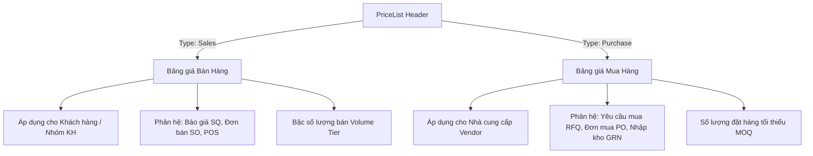

# ERPm — Đặc tả nghiệp vụ Bảng giá chuẩn ERP & Quản lý Địa chỉ Đối tác

> **Tài liệu tham chiếu:** Kiến trúc chuẩn ERP (SAP S/4HANA / Business One, Odoo, Oracle NetSuite)  
> **Áp dụng cho:** Phân hệ Bán hàng (SD), Mua hàng (MM/PO), Khách hàng & Nhà cung cấp (CRM/Partner), Kế toán (FI)  
> **Phiên bản:** 1.0 · **Ngày lập:** 2026-11-13 · **Trạng thái:** Approved Architecture

---

## 1. TỔNG QUAN & MỤC TIÊU KIẾN TRÚC

Hệ thống ERPm phục vụ mô hình doanh nghiệp đa chi nhánh, giao dịch hỗn hợp cả B2B (bán buôn, công nợ) và B2C (bán lẻ, điểm bán POS). Hai nghiệp vụ nền tảng cần chuẩn hóa:
1. **Địa chỉ đối tác (Partner Addresses):** Một đối tác (Khách hàng hoặc Nhà cung cấp) luôn có nhiều địa điểm hoạt động (trụ sở, văn phòng đại diện, nhà máy, kho nhận hàng). Hệ thống phải quản lý tập trung, tự động đề xuất địa chỉ mặc định khi lập chứng từ và **bảo toàn tuyệt đối tính bất biến của lịch sử giao dịch (Snapshot Pattern)**.
2. **Bảng giá doanh nghiệp (Enterprise Price List):** Mở rộng hệ thống bảng giá đa chiều, tách bạch bảng giá Bán và Mua, phân định rõ cơ chế thuế (Đã gồm thuế vs Chưa gồm thuế), quản lý hiệu lực theo Phiên bản (Versioning), hỗ trợ nhân bản và chiết khấu bậc số lượng (Volume Tiers).

---

## 2. THIẾT KẾ ĐỊA CHỈ ĐỐI TÁC (PARTNER ADDRESS ARCHITECTURE)

### 2.1. Phân loại loại địa chỉ (Address Types)
Một đối tác có danh bạ nhiều địa chỉ; mỗi địa chỉ được phân loại theo mục đích sử dụng:

| Mã loại | Tên loại | Mục đích & Áp dụng trên chứng từ |
| :--- | :--- | :--- |
| `Shipping` / `Delivery` | **Địa chỉ giao hàng** | Nơi kho/nhà máy tiếp nhận hàng hóa thực tế. Dùng cho Báo giá (SQ), Đơn bán (SO), Lệnh xuất kho (DO), Đơn mua (PO), Phiếu nhập kho (GRN). |
| `Billing` / `Invoice` | **Địa chỉ hóa đơn** | Tên pháp nhân, Mã số thuế, địa chỉ ghi trên Hóa đơn điện tử VAT. Dùng cho Hóa đơn bán (AR Invoice), Hóa đơn mua (AP Invoice). |
| `Headquarter` / `Office` | **Trụ sở chính / Văn phòng** | Địa chỉ pháp lý chính thức, nơi gửi công văn, hợp đồng, đối chiếu công nợ. |
| `General` | **Khác / Liên hệ chung** | Điểm giao dịch phụ, chi nhánh văn phòng. |

### 2.2. Cơ chế Địa chỉ mặc định (Default Address Resolution)
- Mỗi đối tác được phép chọn **1 địa chỉ giao hàng mặc định** (`IsDefault = true`).
- Khi tạo mới chứng từ (Báo giá, Đơn bán, Đơn mua):
  1. Nếu đối tác có địa chỉ giao hàng mặc định (`isDefault = true`) ➔ Tự động gán vào chứng từ.
  2. Nếu không có địa chỉ mặc định nhưng có danh sách địa chỉ ➔ Gán địa chỉ đầu tiên.
  3. Nếu đối tác chưa có địa chỉ phụ nào ➔ Lấy địa chỉ pháp lý chung tại `Partner.Address`.
  4. Người lập chứng từ luôn có quyền chọn địa chỉ khác từ danh sách thả xuống hoặc nhập địa chỉ tùy biến nếu giao tại điểm phát sinh ngoài danh mục.

### 2.3. Quy tắc bảo toàn lịch sử dữ liệu (Snapshot Pattern)

> [!IMPORTANT]
> **Nguyên tắc bất biến của chứng từ (Document Immutability):**
> Tuyệt đối không dùng quan hệ `JOIN` động sang bảng danh mục địa chỉ khi hiển thị hoặc in ấn chứng từ đã phát sinh.

```
[Bảng danh mục: PartnerDeliveryAddresses]
    id: 101, address: "Kho A, KCN Yên Phong, Bắc Ninh"
           │
           │ (Thời điểm lập Đơn hàng SO-001)
           ▼
[Bản chụp trên chứng từ: SalesOrders]
    DeliveryAddressId: 101                      <-- Giữ ID để truy vết/thống kê
    DeliveryRecipientName: "Nguyễn Văn A"      <-- Snapshot cứng
    DeliveryPhone: "0912 345 678"               <-- Snapshot cứng
    DeliveryAddressText: "Kho A, KCN Yên Phong" <-- Snapshot cứng
```

**Hành vi hệ thống:**
1. **Sau này khách hàng dời kho và sửa địa chỉ 101 thành "Kho B, KCN Quế Võ":**
   - Đơn hàng `SO-001` trong quá khứ **giữ nguyên 100% text "Kho A, KCN Yên Phong"**.
   - Hóa đơn VAT, phiếu xuất kho và lịch sử kế toán không bị sai lệch.
2. **Khách hàng xóa địa chỉ 101 khỏi danh bạ:**
   - Đơn hàng cũ vẫn giữ đầy đủ tên, số điện thoại và địa chỉ giao hàng lịch sử, không phát sinh lỗi liên kết mồ côi (orphaned foreign key).
3. **Khi đơn hàng ở trạng thái `Confirmed` trở đi:** Khóa cứng toàn bộ thông tin địa chỉ trên chứng từ.

---

## 3. THIẾT KẾ BẢNG GIÁ CHUẨN ERP (ENTERPRISE PRICE LIST ARCHITECTURE)

### 3.1. Phân loại 2 chiều: Bảng giá Bán (Sales) vs Bảng giá Mua (Purchase)



- **Bảng giá Bán (Sales Price List):**
  - Quản lý mức giá chào bán cho từng phân khúc thị trường (Bán lẻ, Đại lý cấp 1, Đại lý cấp 2, Dự án B2B, Khách VIP).
  - Có thể gán mặc định cho 1 Khách hàng (`Partner.PriceListId`) hoặc áp dụng rộng rãi theo Chi nhánh / Toàn công ty.
- **Bảng giá Mua (Purchase / Vendor Price List):**
  - Quản lý đơn giá thỏa thuận với từng Nhà cung cấp.
  - Một mặt hàng có thể có nhiều nhà cung cấp khác nhau với giá mua và MOQ khác nhau.
  - Khi lập Đơn mua hàng (PO), hệ thống tự động tải giá mua của nhà cung cấp đó để đề xuất, ngăn chặn việc mua hàng vượt giá thỏa thuận khung.

---

### 3.2. Cơ chế Thuế: Giá đã bao gồm thuế chưa (`IsTaxInclusive`)

Một bảng giá bắt buộc phải khai báo thuộc tính xử lý thuế tại Header:

#### A. Chưa bao gồm thuế (`IsTaxInclusive = false` / Tax Exclusive) — Chuẩn B2B
- Đơn giá trong bảng giá là đơn giá thuần (Net Price).
- Thuế VAT tính bổ sung theo từng dòng hàng:
  $$\text{LineTotal} = \text{UnitPrice} \times \text{Quantity} - \text{DiscountAmount}$$
  $$\text{TaxAmount} = \text{LineTotal} \times \text{VatRate}\%$$
  $$\text{TotalPayable} = \text{LineTotal} + \text{TaxAmount}$$

#### B. Đã bao gồm thuế (`IsTaxInclusive = true` / Tax Inclusive) — Chuẩn B2C & POS
- Đơn giá trong bảng giá là số tiền người mua thực trả (Gross Price).
- Hệ thống tự động bóc tách doanh thu thuần và tiền thuế VAT để hạch toán sổ sách kế toán:
  $$\text{GrossTotal} = \text{UnitPrice} \times \text{Quantity} - \text{DiscountAmount}$$
  $$\text{NetTotal} = \frac{\text{GrossTotal}}{1 + \text{VatRate}\%}$$
  $$\text{TaxAmount} = \text{GrossTotal} - \text{NetTotal}$$

---

### 3.3. Quản lý Phiên bản Bảng giá (Price List Versioning & Lifecycle)

Doanh nghiệp định kỳ thay đổi giá (theo mùa vụ, quý, năm, tỷ giá biến động). Không được sửa đè bảng giá đang chạy.

#### Cấu trúc 3 cấp dữ liệu:
1. **Cấp 1 — Price List Header:** Định danh bảng giá, Loại (Bán/Mua), Tiền tệ, Cờ thuế, Phạm vi Chi nhánh / Toàn hệ thống.
2. **Cấp 2 — Price List Version:** Quản lý vòng đời và thời gian hiệu lực:
   - `VersionCode`: ví dụ `v1.0 (Q1-2026)`, `v2.0 (Q2-2026)`.
   - `EffectiveFrom` & `EffectiveTo`: Khoảng thời gian áp dụng.
   - `Status`:
     - `Draft`: Phiên bản đang soạn thảo, chuẩn bị ban hành. Chưa được áp dụng vào đơn hàng.
     - `Active`: Phiên bản đang có hiệu lực trong kỳ.
     - `Expired`: Phiên bản đã qua thời gian `EffectiveTo`.
     - `Archived`: Phiên bản bị đóng sớm hoặc lưu trữ.
3. **Cấp 3 — Price List Items:** Chi tiết sản phẩm, đơn vị tính (UoM), đơn giá và bậc số lượng.

#### Các tính năng tự động hóa nghiệp vụ:
- **Nhân bản phiên bản (Clone Version):** Sao chép toàn bộ danh mục hàng hóa từ Version cũ sang Version mới chỉ bằng 1 thao tác.
- **Điều chỉnh giá hàng loạt (Bulk Price Adjustment):**
  - Điều chỉnh theo phần trăm: `Tăng +5%` hoặc `Giảm -3%`.
  - Điều chỉnh theo số tiền cố định: `+15.000 đ/sản phẩm`.
  - Quy tắc làm tròn số (Rounding Rules): Làm tròn đến hàng nghìn (`1.000 đ`), mười nghìn (`10.000 đ`) để báo giá niêm yết chẵn đẹp.
- **Tra cứu vết giá (Price Audit Trail):** Truy vết giá của sản phẩm tại bất kỳ ngày nào trong quá khứ hoặc tương lai.

---

### 3.4. Thuật toán giải quyết ưu tiên giá (Pricing Priority Engine)

Khi đưa một sản phẩm vào Báo giá / Đơn hàng, động cơ định giá (`PricingEngine`) giải quyết theo thứ tự ưu tiên giảm dần:

1. **Mức 1 — Giá chỉ định riêng cho Đối tác:** Bảng giá gán đích danh trong hồ sơ khách hàng/NCC (`Partner.PriceListId`).
2. **Mức 2 — Giá theo Nhóm đối tác:** Bảng giá áp dụng cho phân khúc đối tác (Đại lý cấp 1, VIP, Nhà bán buôn...).
3. **Mức 3 — Giá riêng theo Chi nhánh:** Bảng giá đặc thù của chi nhánh giao dịch (`BranchId == CurrentBranchId`).
4. **Mức 4 — Bảng giá Chiến dịch / Khuyến mãi:** Bảng giá có thời hạn hiệu lực gần nhất với ngày chứng từ.
5. **Mức 5 — Bảng giá chuẩn toàn hệ thống:** Bảng giá chung không giới hạn chi nhánh (`BranchId == null`).
6. **Mức 6 — Giá cơ sở (Fallback):** Đơn giá niêm yết gốc trong danh mục hàng hóa (`Item.SalePrice` hoặc `Item.CostPrice`).

**Trong cùng một bảng giá:** So khớp bậc số lượng `MinQuantity` — Lấy mức giá của bậc cao nhất mà số lượng đặt hàng thỏa mãn (`Quantity >= MinQuantity`).

---

## 4. BẢNG THIẾT KẾ SCHEMA DATABASE ĐỀ XUẤT

```sql
-- 1. Bảng giá Header
CREATE TABLE "PriceLists" (
    "Id" SERIAL PRIMARY KEY,
    "Code" VARCHAR(50) NOT NULL UNIQUE,
    "Name" VARCHAR(255) NOT NULL,
    "Type" INT NOT NULL DEFAULT 1,             -- 1: Sales, 2: Purchase
    "Currency" VARCHAR(3) NOT NULL DEFAULT 'VND',
    "IsTaxInclusive" BOOLEAN NOT NULL DEFAULT FALSE,
    "BranchId" INT NULL REFERENCES "Branches"("Id"),
    "PartnerGroupId" INT NULL,
    "IsActive" BOOLEAN NOT NULL DEFAULT TRUE,
    "Notes" TEXT NULL,
    -- Audit fields
    "CreatedAt" TIMESTAMPTZ NOT NULL DEFAULT NOW(),
    "CreatedBy" VARCHAR(100) NULL,
    "UpdatedAt" TIMESTAMPTZ NULL,
    "UpdatedBy" VARCHAR(100) NULL,
    "IsDeleted" BOOLEAN NOT NULL DEFAULT FALSE
);

-- 2. Phiên bản Bảng giá
CREATE TABLE "PriceListVersions" (
    "Id" SERIAL PRIMARY KEY,
    "PriceListId" INT NOT NULL REFERENCES "PriceLists"("Id") ON DELETE CASCADE,
    "VersionCode" VARCHAR(50) NOT NULL,        -- v1.0, v2.0
    "Status" INT NOT NULL DEFAULT 0,           -- 0: Draft, 1: Active, 2: Expired, 3: Archived
    "EffectiveFrom" TIMESTAMPTZ NOT NULL,
    "EffectiveTo" TIMESTAMPTZ NULL,
    "Notes" TEXT NULL,
    -- Audit fields
    "CreatedAt" TIMESTAMPTZ NOT NULL DEFAULT NOW(),
    "CreatedBy" VARCHAR(100) NULL,
    "UpdatedAt" TIMESTAMPTZ NULL,
    "UpdatedBy" VARCHAR(100) NULL,
    "IsDeleted" BOOLEAN NOT NULL DEFAULT FALSE,
    CONSTRAINT "UQ_PriceList_VersionCode" UNIQUE ("PriceListId", "VersionCode")
);

-- 3. Chi tiết Đơn giá theo Sản phẩm & Bậc số lượng
CREATE TABLE "PriceListItems" (
    "Id" SERIAL PRIMARY KEY,
    "PriceListVersionId" INT NOT NULL REFERENCES "PriceListVersions"("Id") ON DELETE CASCADE,
    "ItemId" INT NOT NULL REFERENCES "Items"("Id"),
    "UomId" INT NULL REFERENCES "UnitsOfMeasure"("Id"),
    "UnitPrice" DECIMAL(18, 4) NOT NULL DEFAULT 0,
    "MinQuantity" DECIMAL(18, 4) NOT NULL DEFAULT 0,
    "DiscountPercent" DECIMAL(18, 4) NOT NULL DEFAULT 0,
    CONSTRAINT "UQ_Version_Item_Tier" UNIQUE ("PriceListVersionId", "ItemId", "MinQuantity", "UomId")
);
```

---

## 5. HỢP ĐỒNG API CHI TIẾT (API CONTRACT)

> **Tiền tố chung:** `/api/v1`  
> **Xác thực:** Bearer Token JWT (`Authorization: Bearer <token>`)  
> **Cấu trúc phản hồi chuẩn:**
> ```json
> {
>   "success": true,
>   "message": "common.success",
>   "data": { ... },
>   "errors": []
> }
> ```

### 5.1. Bảng ma trận API Endpoints (API Endpoints Matrix)

| # | Phân hệ | Method | URL Endpoint | Quyền (Permission) | Chức năng & Nghiệp vụ | Request Body | Response Data |
| :- | :--- | :--- | :--- | :--- | :--- | :--- | :--- |
| **A** | **Bảng giá (Price Lists)** | | | | | | |
| 1 | SD | `GET` | `/sales/price-lists` | `sd:pricelist:view` | Lấy danh sách bảng giá (hỗ trợ filter `?type=Sales/Purchase&isActive=true`) | - | `PriceListDto[]` |
| 2 | SD | `GET` | `/sales/price-lists/{id}` | `sd:pricelist:view` | Lấy chi tiết bảng giá (kèm danh sách phiên bản tóm tắt) | - | `PriceListDetailDto` |
| 3 | SD | `POST` | `/sales/price-lists` | `sd:pricelist:create` | Tạo mới bảng giá | `CreatePriceListRequest` | `PriceListDetailDto` |
| 4 | SD | `PUT` | `/sales/price-lists/{id}` | `sd:pricelist:edit` | Cập nhật thông tin chung bảng giá | `UpdatePriceListRequest` | `PriceListDetailDto` |
| 5 | SD | `DELETE`| `/sales/price-lists/{id}` | `sd:pricelist:delete` | Xóa mềm bảng giá (chỉ cho phép khi chưa có chứng từ dùng) | - | 204 No Content |
| **B** | **Phiên bản Bảng giá (Price List Versions)** | | | | | | |
| 6 | SD | `GET` | `/sales/price-lists/{priceListId}/versions` | `sd:pricelist:view` | Danh sách tất cả phiên bản của một bảng giá | - | `PriceListVersionDto[]` |
| 7 | SD | `GET` | `/sales/price-lists/{priceListId}/versions/{id}` | `sd:pricelist:view` | Chi tiết phiên bản (kèm danh sách items) | - | `PriceListVersionDetailDto` |
| 8 | SD | `POST` | `/sales/price-lists/{priceListId}/versions` | `sd:pricelist:edit` | Tạo phiên bản giá mới (trạng thái khởi tạo `Draft`) | `CreatePriceListVersionRequest` | `PriceListVersionDetailDto` |
| 9 | SD | `PUT` | `/sales/price-lists/{priceListId}/versions/{id}` | `sd:pricelist:edit` | Sửa thông tin phiên bản (chỉ cho phép khi trạng thái `Draft`) | `UpdatePriceListVersionRequest` | `PriceListVersionDetailDto` |
| 10 | SD | `POST` | `/sales/price-lists/{priceListId}/versions/{id}/activate` | `sd:pricelist:edit` | Kích hoạt phiên bản thành `Active` (chính thức áp dụng) | - | `PriceListVersionDto` |
| 11 | SD | `POST` | `/sales/price-lists/{priceListId}/versions/{id}/close` | `sd:pricelist:edit` | Đóng phiên bản giá, chuyển thành `Expired` | - | `PriceListVersionDto` |
| 12 | SD | `POST` | `/sales/price-lists/{priceListId}/versions/{id}/clone` | `sd:pricelist:edit` | Nhân bản toàn bộ giá sang phiên bản mới (hỗ trợ tăng/giảm giá ngay khi sao chép) | `ClonePriceListVersionRequest` | `PriceListVersionDetailDto` |
| 13 | SD | `POST` | `/sales/price-lists/{priceListId}/versions/{id}/adjust-prices` | `sd:pricelist:edit` | Điều chỉnh giá hàng loạt trên các items của phiên bản (+X%, làm tròn) | `AdjustPricesRequest` | `PriceAdjustmentResultDto` |
| **C** | **Chi tiết Mặt hàng trong Phiên bản (Price List Items)** | | | | | | |
| 14 | SD | `GET` | `/sales/price-lists/{priceListId}/versions/{id}/items` | `sd:pricelist:view` | Lấy danh sách items có phân trang và tìm kiếm SKU/Tên | Query: `page`, `pageSize`, `search` | `PagedResult<PriceListItemDto>` |
| 15 | SD | `POST` | `/sales/price-lists/{priceListId}/versions/{id}/items` | `sd:pricelist:edit` | Thêm sản phẩm và bậc số lượng vào phiên bản | `CreatePriceListItemRequest` | `PriceListItemDto` |
| 16 | SD | `PUT` | `/sales/price-lists/{priceListId}/versions/{id}/items/{itemId}` | `sd:pricelist:edit` | Cập nhật đơn giá, số lượng tối thiểu hoặc chiết khấu | `UpdatePriceListItemRequest` | `PriceListItemDto` |
| 17 | SD | `DELETE`| `/sales/price-lists/{priceListId}/versions/{id}/items/{itemId}` | `sd:pricelist:edit` | Xóa mặt hàng khỏi phiên bản giá | - | 204 No Content |
| **D** | **Động cơ định giá (Pricing Engine)** | | | | | | |
| 18 | SD | `POST` | `/sales/price-lists/calculate-price` | `sd:order:view` | Tính giá tự động theo khách hàng, bảng giá, ngày chứng từ và bóc tách thuế | `CalculatePriceRequest` | `CalculatePriceResponse` |
| **E** | **Báo giá Bán hàng (Sales Quotations)** | | | | | | |
| 19 | SD | `POST` | `/sales/quotations` | `sd:quotation:create` | Tạo báo giá mới (bổ sung lưu Snapshot Địa chỉ & PriceListId) | `CreateSalesQuotationRequest` | `SalesQuotationDetailDto` |
| 20 | SD | `PUT` | `/sales/quotations/{id}` | `sd:quotation:edit` | Cập nhật báo giá (bổ sung lưu Snapshot Địa chỉ & PriceListId) | `UpdateSalesQuotationRequest` | `SalesQuotationDetailDto` |
| 21 | SD | `POST` | `/sales/quotations/{id}/convert-to-order` | `sd:order:create` | Chuyển Báo giá thành Đơn bán hàng (kế thừa nguyên vẹn Snapshot Địa chỉ) | - | `ConvertQuotationResponse` |
| **F** | **Địa chỉ Đối tác CRM (Partner Delivery Addresses)** | | | | | | |
| 22 | CRM | `GET` | `/partners/{partnerId}/delivery-addresses` | `crm:partner:view` | Lấy danh bạ địa chỉ đối tác (bổ sung trường `addressType`) | - | `DeliveryAddressDto[]` |
| 23 | CRM | `POST` | `/partners/{partnerId}/delivery-addresses` | `crm:partner:create`| Thêm địa chỉ mới (nhận `addressType`: Shipping/Billing/Office/General) | `SaveDeliveryAddressRequest` | `DeliveryAddressDto` |
| 24 | CRM | `PUT` | `/partners/{partnerId}/delivery-addresses/{id}` | `crm:partner:create`| Cập nhật địa chỉ (nhận `addressType`) | `SaveDeliveryAddressRequest` | `DeliveryAddressDto` |

---

### 5.2. Định nghĩa DTO Request & Response (JSON Schemas)

#### 1. Bảng giá (Price List)
```jsonc
// POST /api/v1/sales/price-lists
// CreatePriceListRequest
{
  "code": "PL-SALES-RETAIL",
  "name": "Bảng giá Bán lẻ 2026",
  "type": "Sales",                 // "Sales" (Bán hàng) | "Purchase" (Mua hàng)
  "isTaxInclusive": true,          // true: Giá đã gồm thuế VAT | false: Giá chưa gồm thuế
  "currency": "VND",               // Mặc định "VND"
  "description": "Áp dụng cho khách lẻ và cửa hàng POS",
  "isActive": true
}

// GET /api/v1/sales/price-lists/{id}
// PriceListDetailDto
{
  "id": 1,
  "code": "PL-SALES-RETAIL",
  "name": "Bảng giá Bán lẻ 2026",
  "type": "Sales",
  "isTaxInclusive": true,
  "currency": "VND",
  "description": "Áp dụng cho khách lẻ và cửa hàng POS",
  "isActive": true,
  "activeVersionId": 10,
  "versions": [
    {
      "id": 10,
      "versionCode": "v1.0",
      "status": 1,                 // 0: Draft, 1: Active, 2: Expired, 3: Archived
      "effectiveFrom": "2026-01-01T00:00:00Z",
      "effectiveTo": "2026-12-31T23:59:59Z",
      "itemsCount": 120
    }
  ],
  "createdAt": "2026-11-13T01:00:00Z"
}
```

#### 2. Phiên bản Bảng giá (Price List Version)
```jsonc
// POST /api/v1/sales/price-lists/{priceListId}/versions
// CreatePriceListVersionRequest
{
  "versionCode": "v2.0",
  "effectiveFrom": "2027-01-01T00:00:00Z",
  "effectiveTo": null,
  "notes": "Áp dụng điều chỉnh giá năm 2027"
}

// POST /api/v1/sales/price-lists/{priceListId}/versions/{id}/clone
// ClonePriceListVersionRequest
{
  "targetVersionCode": "v2.1",
  "effectiveFrom": "2026-07-01T00:00:00Z",
  "effectiveTo": null,
  "percentageAdjustment": 5.0,     // Tăng giá 5% toàn bộ items (nhập âm nếu giảm)
  "fixedAdjustment": 0,            // Cộng thêm tiền cố định (nếu có)
  "roundingMethod": "Nearest1000", // "None" | "Nearest1000" | "Nearest10000" | "Ceil1000"
  "notes": "Nhân bản từ v2.0 và trượt giá 5%"
}

// POST /api/v1/sales/price-lists/{priceListId}/versions/{id}/adjust-prices
// AdjustPricesRequest
{
  "itemIds": [101, 102, 105],      // Mảng Id mặt hàng cần sửa (hoặc để rỗng/null nếu áp dụng toàn bộ)
  "percentageAdjustment": 10.0,    // Tăng 10%
  "fixedAdjustment": 0,
  "roundingMethod": "Nearest1000"
}

// POST /api/v1/sales/price-lists/{priceListId}/versions/{id}/items
// CreatePriceListItemRequest
{
  "itemId": 50,
  "uomId": 2,                      // Null nếu theo đơn vị tính chuẩn của Item
  "unitPrice": 150000.0000,
  "minQuantity": 1.0000,           // Bậc số lượng tối thiểu để hưởng giá này
  "discountPercent": 0.0000
}
```

#### 3. Động cơ tính giá (Pricing Engine)
```jsonc
// POST /api/v1/sales/price-lists/calculate-price
// CalculatePriceRequest
{
  "partnerId": 12,                 // Khách hàng
  "branchId": 1,
  "orderDate": "2026-11-13T00:00:00Z", // Ngày chứng từ để tìm Version Active có hiệu lực
  "priceListId": 1,                // Tùy chọn: chỉ định cụ thể hoặc để null để engine tự tìm
  "lines": [
    {
      "itemId": 50,
      "uomId": 2,
      "quantity": 10.0000,
      "vatRate": 10.0000           // % thuế VAT của dòng hàng
    }
  ]
}

// CalculatePriceResponse
{
  "priceListId": 1,
  "priceListName": "Bảng giá Bán lẻ 2026",
  "versionCode": "v1.0",
  "isTaxInclusive": true,          // Báo cho FE biết đơn giá này ĐÃ bao gồm thuế
  "lines": [
    {
      "itemId": 50,
      "quantity": 10.0000,
      "rawUnitPrice": 150000.0000, // Đơn giá lấy từ PriceListItem
      "netUnitPrice": 136363.6364, // Đơn giá trước thuế (đã bóc tách = 150,000 / 1.1)
      "discountPercent": 0.0000,
      "netAmount": 1363636.3640,   // Tiền trước thuế = 136,363.6364 * 10
      "taxAmount": 136363.6360,    // Tiền VAT 10%
      "grossAmount": 1500000.0000  // Tổng tiền thanh toán gồm VAT = 1,500,000
    }
  ]
}
```

#### 4. Báo giá (Sales Quotation) tích hợp Snapshot Địa chỉ
```jsonc
// POST /api/v1/sales/quotations hoặc PUT /api/v1/sales/quotations/{id}
// CreateSalesQuotationRequest / UpdateSalesQuotationRequest
{
  "partnerId": 12,
  "priceListId": 1,
  "quotationDate": "2026-11-13T00:00:00Z",
  "deliveryAddressId": 101,                           // ID địa chỉ trong CRM (để đối chiếu)
  "deliveryRecipientName": "Nguyễn Văn A",            // [Snapshot] Tên người nhận
  "deliveryPhone": "0912345678",                      // [Snapshot] SĐT nhận hàng
  "deliveryAddressText": "Kho A, KCN Quế Võ, Bắc Ninh",// [Snapshot] Địa chỉ giao hàng đầy đủ
  "items": [
    {
      "itemId": 50,
      "quantity": 10.0000,
      "unitPrice": 136363.6364,
      "vatRate": 10.0000
    }
  ]
}
```

#### 5. Danh bạ Địa chỉ Đối tác CRM (Partner Delivery Addresses)
```jsonc
// POST /api/v1/partners/{partnerId}/delivery-addresses
// SaveDeliveryAddressRequest
{
  "recipientName": "Nguyễn Văn A",
  "phone": "0912345678",
  "address": "Kho A, KCN Quế Võ",
  "city": "Bắc Ninh",
  "district": "Quế Võ",
  "ward": "Vân Dương",
  "addressType": "Shipping",       // "Shipping" | "Billing" | "Office" | "General" (mặc định "Shipping")
  "isDefault": true
}

// DeliveryAddressDto
{
  "id": 101,
  "partnerId": 12,
  "recipientName": "Nguyễn Văn A",
  "phone": "0912345678",
  "address": "Kho A, KCN Quế Võ",
  "city": "Bắc Ninh",
  "district": "Quế Võ",
  "ward": "Vân Dương",
  "addressType": "Shipping",
  "isDefault": true,
  "createdAt": "2026-11-08T10:00:00Z"
}
```

---

### 5.3. Bảng mã lỗi tiêu chuẩn (Standard Error Codes Matrix)

| HTTP Status | Mã lỗi hệ thống (Error Code) | Thông điệp tiếng Anh (EN) | Thông điệp tiếng Việt (VI) |
| :--- | :--- | :--- | :--- |
| `404 Not Found` | `error.sales.price_list_not_found` | Price list not found | Không tìm thấy bảng giá |
| `404 Not Found` | `error.sales.price_list_version_not_found` | Price list version not found | Không tìm thấy phiên bản bảng giá |
| `404 Not Found` | `error.sales.price_list_item_not_found` | Price list item not found | Không tìm thấy mặt hàng trong bảng giá |
| `400 Bad Request` | `error.sales.price_list_version_code_duplicate` | Version code already exists for this price list | Mã phiên bản đã tồn tại trong bảng giá này |
| `400 Bad Request` | `error.sales.price_list_version_immutable` | Cannot modify a version that is already Active or Expired | Không thể chỉnh sửa phiên bản đã Kích hoạt hoặc Hết hạn |
| `400 Bad Request` | `error.sales.price_list_version_dates_invalid` | EffectiveTo must be greater than EffectiveFrom | Ngày hết hạn phải lớn hơn ngày bắt đầu hiệu lực |
| `422 Unprocessable`| `error.sales.no_active_price_list_version` | No active price list version found for the specified date | Không tìm thấy phiên bản bảng giá có hiệu lực cho ngày chứng từ |
| `400 Bad Request` | `error.sales.price_list_in_use_cannot_delete` | Cannot delete price list that is currently referenced by orders or quotations | Không thể xóa bảng giá đang được sử dụng trong đơn hàng hoặc báo giá |
| `404 Not Found` | `error.crm.partner_not_found` | Partner not found | Không tìm thấy đối tác |
| `404 Not Found` | `error.crm.delivery_address_not_found` | Delivery address not found | Không tìm thấy địa chỉ giao hàng |
| `422 Unprocessable`| `error.crm.delivery_address_limit` | A partner can have at most 20 delivery addresses | Mỗi đối tác chỉ được lưu tối đa 20 địa chỉ |

---

## 6. KẾT LUẬN & ĐỊNH HƯỚNG TRIỂN KHAI

Tài liệu đặc tả nghiệp vụ và Hợp đồng API này là căn cứ kiến trúc chính thức để phân rã nhiệm vụ chi tiết trong **Plan Step 25**, đảm bảo việc phát triển tính năng diễn ra đồng bộ giữa BE và FE, không phá vỡ dữ liệu lịch sử và tương thích 100% với các phân hệ hiện có của ERPm.

