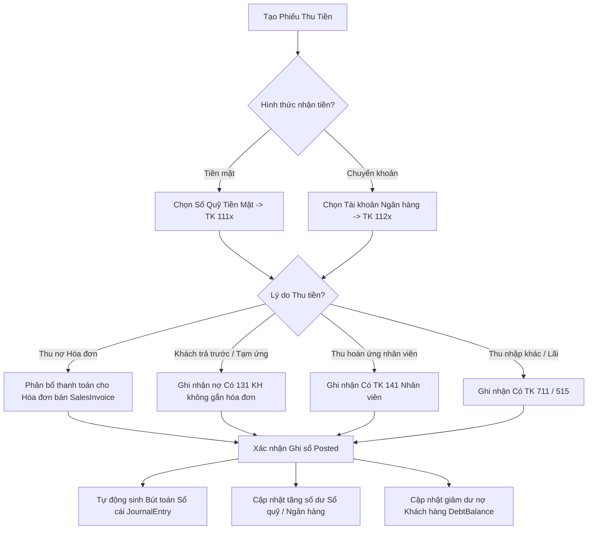

# ERPm — Đặc tả nghiệp vụ Quản lý Dòng tiền (Treasury), Sổ quỹ, Phiếu Thu/Chi & Module Kế toán Tích hợp Động

> **Tài liệu tham chiếu:** Chuẩn Kế toán Doanh nghiệp Việt Nam (Thông tư 200/2014/TT-BTC & 133/2016/TT-BTC), Kiến trúc Tài chính ERP Chuẩn (SAP FI/CO, Odoo Accounting, Oracle NetSuite)  
> **Áp dụng cho:** Phân hệ Kế toán (ACC - General Ledger), Quản trị Dòng tiền (Treasury - Cash/Bank), Bán hàng (SD), Mua hàng (PUR), CRM/Đối tác  
> **Phiên bản:** 1.0 · **Ngày lập:** 2026-11-15 · **Trạng thái:** Chờ Duyệt (Pending PO Approval)

---

## 1. TỔNG QUAN & BỐI CẢNH NGHIỆP VỤ (EXECUTIVE SUMMARY)

### 1.1. Hiện trạng hệ thống ERPm
1. **Bán hàng & Hóa đơn:** Đã có Báo giá (`SalesQuotation`), Đơn bán (`SalesOrder`) và Hóa đơn bán hàng (`SalesInvoice`). Khi lập hóa đơn, hệ thống ghi nhận doanh thu và dư nợ của khách hàng (`DebtBalance`), nhưng **chưa có cơ chế Thu tiền thực tế** để giảm trừ công nợ.
2. **Kế toán hardcode:** Trong `SalesPostingService`, các số hiệu tài khoản kế toán đang bị **gán cứng (hardcoded)** dưới dạng chuỗi ký tự (`"511"`, `"111"`, `"112"`, `"131"`, `"632"`, `"156"`).
3. **Khoảng trống:**
   - Khi doanh nghiệp mở thêm chi nhánh, mở nhiều tài khoản ngân hàng (Vietcombank, Techcombank, ACB...) hoặc phân loại nhiều nhóm khách hàng (Bán buôn, Bán lẻ, Xuất khẩu), việc hardcode tài khoản sẽ gây xung đột dữ liệu và không thể hạch toán độc lập theo từng chi nhánh/quỹ tiền.
   - Thiếu phân hệ **Quản trị Dòng tiền (Treasury / Cash & Bank)**: Doanh nghiệp không nắm được hôm nay quỹ tiền mặt còn bao nhiêu tiền, từng tài khoản ngân hàng số dư bao nhiêu, khách hàng nào còn nợ quá hạn.

### 1.2. Mục tiêu kiến trúc Step 26
1. **Thiết lập Module Kế toán lõi (ACC - Financial Accounting):**
   - Quản lý Hệ thống Tài khoản Kế toán (`Chart of Accounts - COA`) chuẩn Thông tư 200/133 dạng cây phân cấp đa tầng.
   - Xây dựng **Động cơ Định khoản Động (Dynamic Account Determination & Posting Engine)**: Cho phép cấu hình tài khoản linh hoạt theo Chi nhánh, Sổ quỹ, Ngân hàng, Nhóm đối tác và Nhóm sản phẩm mà không sửa một dòng code nào.
2. **Phân hệ Quản trị Dòng tiền & Sổ quỹ (Treasury, Cash & Bank):**
   - Quản lý danh mục Sổ quỹ tiền mặt (Cash Funds) và Tài khoản ngân hàng (Bank Accounts).
   - **Phiếu Thu (Receipt Voucher - PT):** Thu tiền bán hàng, thu công nợ khách hàng, thu hoàn ứng, thu khác. Hỗ trợ **cơ chế cấn trừ hóa đơn (Invoice Allocation)** linh hoạt (1 phiếu thu trả nhiều hóa đơn, hoặc 1 hóa đơn trả nhiều lần).
   - **Phiếu Chi (Payment Voucher - PC):** Chi trả nợ nhà cung cấp, chi tạm ứng, chi phí vận hành (điện, nước, tiếp khách, văn phòng phẩm).
   - **Chuyển tiền nội bộ (Internal Cash Transfer):** Nộp tiền mặt vào ngân hàng hoặc rút tiền gửi về nhập quỹ.
3. **Báo cáo Dòng tiền & Đối chiếu Công nợ:**
   - Sổ quỹ tiền mặt & Sổ phụ ngân hàng thời gian thực.
   - Báo cáo phân tích Tuổi nợ (AR Aging Report: 0-30 ngày, 31-60 ngày, 90+ ngày).
   - Bảng đối chiếu công nợ chi tiết theo đối tác (Statement of Account).
   - Sổ Nhật ký chung (General Journal) và Bảng cân đối số phát sinh (Trial Balance).

---

## 2. THIẾT KẾ ĐỘNG CƠ ĐỊNH KHOẢN KẾ TOÁN ĐỘNG (DYNAMIC POSTING ENGINE)

### 2.1. Hệ thống Tài khoản Kế toán Đa cấp (Chart of Accounts - COA)

Cấu trúc tài khoản được lưu trữ phân cấp cha - con (Parent - Child) với các quy tắc nghiệp vụ:

```mermaid
graph TD
    TK1[1 - TÀI SẢN (Asset)] --> TK11[11 - Tiền & Tương đương tiền]
    TK11 --> TK111[111 - Tiền mặt tại quỹ]
    TK111 --> TK1111[1111 - Tiền Việt Nam (Quỹ Trung tâm)]
    TK111 --> TK1112[1112 - Tiền mặt Chi nhánh 1]
    TK11 --> TK112[112 - Tiền gửi ngân hàng]
    TK112 --> TK1121[1121 - Vietcombank VND]
    TK112 --> TK1122[1122 - Techcombank VND]
    
    TK1 --> TK13[13 - Phải thu]
    TK13 --> TK131[131 - Phải thu khách hàng]
    TK131 --> TK1311[1311 - Phải thu KH Trong nước]
    TK131 --> TK1312[1312 - Phải thu KH Nước ngoài]
    
    TK3[3 - NỢ PHẢI TRẢ (Liability)] --> TK33[33 - Phải trả]
    TK33 --> TK331[331 - Phải trả Nhà cung cấp]
    TK33 --> TK333[333 - Thuế & Các khoản nộp NN]
    TK333 --> TK3331[3331 - Thuế GTGT phải nộp]
    
    TK5[5 - DOANH THU (Revenue)] --> TK511[511 - Doanh thu bán hàng & dịch vụ]
    TK6[6 - CHI PHÍ (Expense)] --> TK632[632 - Giá vốn hàng bán]
    TK6 --> TK642[642 - Chi phí quản lý doanh nghiệp]
```

#### Quy tắc nghiệp vụ Tài khoản:
- **Tài khoản Tổng hợp vs Tài khoản Chi tiết (`IsPostable`):**
  - Tài khoản cấp cha (như `111`, `112`, `131`) chỉ dùng để gom nhóm và lên báo cáo tổng hợp (`IsPostable = false`).
  - Mọi giao dịch hạch toán chứng từ bắt buộc phải ghi vào **Tài khoản lá chi tiết nhất** (`IsPostable = true`).
- **Tính chất Số dư (`AccountNature`):**
  - `DebitOnly` (Dư Nợ thuần túy): Tài sản (1xx, 2xx), Chi phí (6xx, 8xx - không có số dư cuối kỳ sau kết chuyển).
  - `CreditOnly` (Dư Có thuần túy): Nợ phải trả (3xx), Vốn chủ sở hữu (4xx), Doanh thu (5xx, 7xx).
  - `Bilateral` (Lưỡng tính): 131 (Phải thu khách hàng - có thể dư Nợ hoặc dư Có nếu khách trả thừa/tạm ứng), 331 (Phải trả NCC).
- **Theo dõi đối tượng phụ trợ (`TrackingDimensions`):**
  - Cờ `TrackPartner`: Bắt buộc phải gắn `PartnerId` khi hạch toán vào TK 131, 331.
  - Cờ `TrackBranch`: Bắt buộc phải gắn `BranchId` để báo cáo độc lập theo từng chi nhánh.

---

### 2.2. Ma trận Cấu hình Định khoản Tự động (Account Posting Profiles)

Hệ thống loại bỏ hoàn toàn việc gán cứng chuỗi mã tài khoản trong source code. Khi nghiệp vụ xảy ra, hệ thống tự động tra cứu bảng cấu hình `AccountPostingProfiles` theo ma trận:

| Nghiệp vụ (Transaction Type) | Trường điều kiện (Dimension Match) | Tài khoản Ghi Nợ (Debit Account) | Tài khoản Ghi Có (Credit Account) | Mô tả nghiệp vụ |
| :--- | :--- | :--- | :--- | :--- |
| **Bán hàng tiền mặt** | `PaymentMethod = Cash` | Lấy từ `CashFund.AccountId` (1111) | Lấy từ `ItemCategory.RevenueAccountId` (5111) | Ghi nhận tiền mặt và doanh thu |
| **Bán hàng chuyển khoản** | `PaymentMethod = Bank` | Lấy từ `BankAccount.AccountId` (1121) | Lấy từ `ItemCategory.RevenueAccountId` (5111) | Ghi nhận tiền gửi ngân hàng |
| **Bán hàng công nợ** | `PaymentMethod = Debt` | Lấy từ `Partner.ReceivableAccountId` hoặc mặc định nhóm KH (1311) | Lấy từ `ItemCategory.RevenueAccountId` (5111) | Ghi nhận công nợ phải thu |
| **Thuế GTGT đầu ra** | Có phát sinh VAT bán hàng | Nợ theo hình thức thanh toán (111/112/131) | Lấy từ `TaxRate.TaxAccountId` (33311) | Ghi nhận thuế VAT đầu ra |
| **Giá vốn xuất kho bán** | Hàng hóa xuất kho | Lấy từ `ItemCategory.CogsAccountId` (6321) | Lấy từ `ItemCategory.InventoryAccountId` (1561) | Ghi nhận giá vốn và giảm kho |
| **Thu tiền nợ khách hàng** | Phiếu Thu - Loại: `CustomerDebt` | Lấy từ `CashFund` (1111) hoặc `BankAccount` (1121) | Lấy từ `Partner.ReceivableAccountId` (1311) | Giảm nợ khách hàng, tăng tiền |
| **Khách hàng trả trước** | Phiếu Thu - Loại: `AdvanceDeposit` | Lấy từ `CashFund` (1111) hoặc `BankAccount` (1121) | Lấy từ `Partner.ReceivableAccountId` (1311) | Ghi nhận khách tạm ứng trước |
| **Chi trả nợ NCC** | Phiếu Chi - Loại: `VendorPayment` | Lấy từ `Partner.PayableAccountId` (3311) | Lấy từ `CashFund` (1111) hoặc `BankAccount` (1121) | Giảm nợ phải trả, giảm tiền |
| **Chi phí vận hành** | Phiếu Chi - Loại: `Expense` | Lấy theo Khoản mục chi phí (6421, 6422...) | Lấy từ `CashFund` (1111) hoặc `BankAccount` (1121) | Ghi nhận chi phí, giảm tiền |
| **Nộp tiền vào ngân hàng** | Chuyển quỹ: Tiền mặt ➔ Ngân hàng | Lấy từ `BankAccount.AccountId` (1121) | Lấy từ `CashFund.AccountId` (1111) | Luân chuyển tiền nội bộ |

---

### 2.3. Quy tắc Bất biến của Bút toán Kép (Double-Entry Bookkeeping Principles)

> [!IMPORTANT]
> **Nguyên tắc Cân đối Bút toán Kép:**
> Mọi `JournalEntry` được sinh ra bắt buộc phải thỏa mãn phương trình:
> $$\sum \text{DebitAmount} = \sum \text{CreditAmount}$$
> Nếu tổng Nợ lệch dù chỉ `0.0001 VND` so với tổng Có, hệ thống lập tức hủy bỏ giao dịch (Rollback Transaction) và báo lỗi `error.accounting.unbalanced_journal`.

- **Nguyên tắc Bất biến của Chứng từ Đã ghi sổ (Posted Immutability):**
  - Chứng từ ở trạng thái `Posted` (Phiếu thu, Phiếu chi, Hóa đơn bán) **tuyệt đối không cho phép sửa hay xóa**.
  - Muốn sửa sai sót: Kế toán phải thực hiện chức năng **Hủy / Đảo bút toán (Reverse / Void)**. Hệ thống sẽ sinh một `JournalEntry` đảo (đảo Nợ thành Có, Có thành Nợ) với trạng thái đối ứng để triệt tiêu dòng tiền sai mà vẫn bảo lưu 100% vết kiểm toán (Audit Trail).

---

## 3. THIẾT KẾ QUẢN TRỊ DÒNG TIỀN & SỔ QUỸ (TREASURY MANAGEMENT)

### 3.1. Danh mục Sổ quỹ & Tài khoản Ngân hàng

Mỗi đơn vị tiền tệ của doanh nghiệp gắn liền với một thực thể quản lý dòng tiền:

1. **Sổ quỹ Tiền mặt (`CashFunds`):**
   - Đại diện cho két sắt tiền mặt tại từng địa điểm: Quỹ Văn phòng Tổng, Quỹ Chi nhánh Đà Nẵng, Quỹ Cửa hàng POS 1...
   - Gắn liền với: `BranchId` (Chi nhánh sở hữu), `CustodianEmployeeId` (Thủ quỹ chịu trách nhiệm), `AccountId` (Tài khoản kế toán tương ứng, ví dụ `1111`, `1112`).
   - Theo dõi: `CurrentBalance` (Số dư tiền mặt thực tế).

2. **Tài khoản Ngân hàng (`BankAccounts`):**
   - Đại diện cho các tài khoản thanh toán tại các ngân hàng thương mại.
   - Thuộc tính: `BankName` (Vietcombank, BIDV, Techcombank...), `AccountNumber` (Số tài khoản), `AccountHolder` (Tên chủ tài khoản), `BranchName` (Chi nhánh ngân hàng), `Currency` (VND, USD), `AccountId` (Gắn TK `1121`, `1122`...).
   - Theo dõi: `CurrentBalance` (Số dư tài khoản ngân hàng).

---

### 3.2. Nghiệp vụ Phiếu Thu Tiền (Receipt Voucher - PT)

Phiếu thu dùng để ghi nhận mọi dòng tiền chảy vào doanh nghiệp (bằng tiền mặt hoặc chuyển khoản ngân hàng):



#### Cơ chế Cấn trừ Hóa đơn Linh hoạt (Invoice Payment Allocation):
- Khi thu tiền công nợ khách hàng, người dùng có thể:
  1. **Chọn đích danh Hóa đơn:** Chọn các hóa đơn chưa thanh toán đủ trong danh sách nợ của khách hàng.
  2. **Tự động cấn trừ theo thứ tự thời gian (FIFO):** Tiền thu sẽ tự động thanh toán cho các hóa đơn lập sớm nhất trước.
  3. **Thu tiền vượt hóa đơn (Overpayment):** Phần tiền thừa tự động chuyển thành số dư trả trước của khách hàng (`Advance Deposit`) để cấn trừ cho các đơn hàng tương lai.

---

### 3.3. Nghiệp vụ Phiếu Chi Tiền (Payment Voucher - PC)

Phiếu chi dùng để ghi nhận mọi dòng tiền chi ra khỏi doanh nghiệp:

1. **Chi trả nợ Nhà cung cấp (`VendorPayment`):** Thanh toán đơn mua hàng (PO) hoặc hóa đơn nhà cung cấp; giảm công nợ phải trả `TK 331`.
2. **Chi tạm ứng cho Nhân viên (`AdvanceToEmployee`):** Tạm ứng công tác, mua hàng; hạch toán `Nợ TK 141 / Có TK 111, 112`.
3. **Chi phí hoạt động doanh nghiệp (`OperatingExpense`):** Trả tiền thuê văn phòng, điện nước, internet, tiếp khách, sửa chữa; hạch toán `Nợ TK 642, 641 / Có TK 111, 112`.
4. **Chi nộp Thuế & Nghĩa vụ Nhà nước (`TaxPayment`):** Nộp thuế GTGT, thuế TNDN, bảo hiểm xã hội; hạch toán `Nợ TK 333 / Có TK 111, 112`.

---

### 3.4. Nghiệp vụ Chuyển tiền Nội bộ (Internal Cash Transfer)

Xảy ra khi luân chuyển dòng tiền giữa các kho tiền trong cùng doanh nghiệp:
- **Nộp tiền mặt vào ngân hàng:** Rút từ Quỹ tiền mặt nộp vào Vietcombank ➔ `Nợ TK 1121 / Có TK 1111`.
- **Rút tiền gửi về nhập quỹ:** Rút từ ngân hàng về quỹ tiền mặt để chi tiêu nhỏ ➔ `Nợ TK 1111 / Có TK 1121`.
- **Điều chuyển tiền giữa các tài khoản ngân hàng:** Chuyển tiền từ Vietcombank sang Techcombank ➔ `Nợ TK 1122 / Có TK 1121`.

---

## 4. BÁO CÁO TÀI CHÍNH & PHÂN TÍCH CÔNG NỢ

### 4.1. Báo cáo Sổ quỹ Tiền mặt & Sổ phụ Ngân hàng (Cash / Bank Books)
Hiển thị luồng tiền vào - ra hàng ngày:
$$\text{Số dư cuối kỳ} = \text{Số dư đầu kỳ} + \sum \text{Tổng Thu} - \sum \text{Tổng Chi}$$

### 4.2. Báo cáo Phân tích Tuổi nợ Khách hàng (AR Aging Report)
Phân tích chi tiết rủi ro công nợ theo từng mốc thời gian dựa trên `DueDate` (Hạn thanh toán) của từng hóa đơn:

| Khách hàng | Tổng nợ hiện tại | Trong hạn (Chưa đến hạn) | Quá hạn 1 - 30 ngày | Quá hạn 31 - 60 ngày | Quá hạn 61 - 90 ngày | Quá hạn trên 90 ngày (Rủi ro cao) |
| :--- | :---: | :---: | :---: | :---: | :---: | :---: |
| Công ty Cổ phần ABC | 150,000,000 | 100,000,000 | 50,000,000 | 0 | 0 | 0 |
| Đại lý Toàn Thắng | 85,000,000 | 0 | 20,000,000 | 35,000,000 | 30,000,000 | 0 |
| Cửa hàng Bán lẻ Minh Phát| 12,000,000 | 0 | 0 | 0 | 0 | 12,000,000 ⚠️ |

### 4.3. Bảng Đối chiếu Công nợ Đối tác (Statement of Account)
Gửi cho khách hàng định kỳ hàng tháng để đối chiếu công nợ song phương:
- Số dư nợ đầu tháng.
- Danh sách các Đơn hàng / Hóa đơn phát sinh trong tháng (+ Nợ).
- Danh sách các Phiếu thu tiền khách đã trả (- Có).
- Danh sách hàng trả lại nếu có (- Có).
- Số dư nợ chốt cuối tháng cần thanh toán.

---

## 5. THIẾT KẾ CƠ SỞ DỮ LIỆU POSTGRESQL (SCHEMA DESIGN)

```sql
-- ============================================================================
-- 1. MỞ RỘNG BẢNG TÀI KHOẢN KẾ TOÁN (Chart of Accounts)
-- ============================================================================
ALTER TABLE "Accounts" 
    ADD COLUMN IF NOT EXISTS "Nature" INT NOT NULL DEFAULT 1,       -- 1: DebitOnly, 2: CreditOnly, 3: Bilateral
    ADD COLUMN IF NOT EXISTS "IsPostable" BOOLEAN NOT NULL DEFAULT TRUE, -- TRUE: TK lá được phép hạch toán
    ADD COLUMN IF NOT EXISTS "TrackPartner" BOOLEAN NOT NULL DEFAULT FALSE, -- TRUE: Bắt buộc chọn Đối tác (131, 331)
    ADD COLUMN IF NOT EXISTS "TrackBranch" BOOLEAN NOT NULL DEFAULT TRUE;   -- TRUE: Phân tách theo Chi nhánh

-- ============================================================================
-- 2. CẤU HÌNH ĐỊNH KHOẢN TỰ ĐỘNG ĐỘNG (Dynamic Account Determination Matrix)
-- ============================================================================
CREATE TABLE "AccountPostingProfiles" (
    "Id" SERIAL PRIMARY KEY,
    "Module" VARCHAR(50) NOT NULL,              -- 'SD', 'PUR', 'TREASURY', 'WMS'
    "TransactionType" VARCHAR(100) NOT NULL,    -- 'SALES_CASH', 'SALES_DEBT', 'RECEIPT_DEBT', 'PAYMENT_VENDOR', 'COGS_ISSUE'
    "BranchId" INT NULL REFERENCES "Branches"("Id"), -- NULL: Áp dụng toàn hệ thống
    "DimensionKey" VARCHAR(100) NULL,           -- Khóa phụ: Mã nhóm KH, Mã nhóm hàng, Loại thanh toán
    "DebitAccountId" INT NOT NULL REFERENCES "Accounts"("Id"),
    "CreditAccountId" INT NOT NULL REFERENCES "Accounts"("Id"),
    "Description" VARCHAR(255) NULL,
    "IsActive" BOOLEAN NOT NULL DEFAULT TRUE,
    "CreatedAt" TIMESTAMPTZ NOT NULL DEFAULT NOW(),
    "CreatedBy" VARCHAR(100) NULL,
    "UpdatedAt" TIMESTAMPTZ NULL,
    "UpdatedBy" VARCHAR(100) NULL,
    CONSTRAINT "UQ_PostingProfile_Key" UNIQUE ("Module", "TransactionType", "BranchId", "DimensionKey")
);

-- ============================================================================
-- 3. DANH MỤC SỔ QUỸ TIỀN MẶT & TÀI KHOẢN NGÂN HÀNG (Treasury Entities)
-- ============================================================================
CREATE TABLE "CashFunds" (
    "Id" SERIAL PRIMARY KEY,
    "Code" VARCHAR(50) NOT NULL UNIQUE,         -- 'QUY-HN', 'QUY-HCM'
    "Name" VARCHAR(255) NOT NULL,               -- 'Quỹ tiền mặt Trụ sở Hà Nội'
    "BranchId" INT NOT NULL REFERENCES "Branches"("Id"),
    "AccountId" INT NOT NULL REFERENCES "Accounts"("Id"), -- Gắn TK 1111, 1112...
    "CustodianEmployeeId" INT NULL REFERENCES "Employees"("Id"),
    "CurrentBalance" DECIMAL(18, 4) NOT NULL DEFAULT 0,
    "Currency" VARCHAR(10) NOT NULL DEFAULT 'VND',
    "IsActive" BOOLEAN NOT NULL DEFAULT TRUE,
    "CreatedAt" TIMESTAMPTZ NOT NULL DEFAULT NOW(),
    "CreatedBy" VARCHAR(100) NULL,
    "UpdatedAt" TIMESTAMPTZ NULL,
    "UpdatedBy" VARCHAR(100) NULL,
    "IsDeleted" BOOLEAN NOT NULL DEFAULT FALSE
);

CREATE TABLE "BankAccounts" (
    "Id" SERIAL PRIMARY KEY,
    "BankName" VARCHAR(100) NOT NULL,           -- 'Vietcombank', 'Techcombank'
    "AccountNumber" VARCHAR(50) NOT NULL,       -- '0011001234567'
    "AccountHolder" VARCHAR(255) NOT NULL,      -- 'CONG TY CP CONG NGHE ERPM'
    "BankBranch" VARCHAR(255) NULL,             -- 'Chi nhánh Ba Đình - Hà Nội'
    "BranchId" INT NOT NULL REFERENCES "Branches"("Id"),
    "AccountId" INT NOT NULL REFERENCES "Accounts"("Id"), -- Gắn TK 1121, 1122...
    "CurrentBalance" DECIMAL(18, 4) NOT NULL DEFAULT 0,
    "Currency" VARCHAR(10) NOT NULL DEFAULT 'VND',
    "IsActive" BOOLEAN NOT NULL DEFAULT TRUE,
    "CreatedAt" TIMESTAMPTZ NOT NULL DEFAULT NOW(),
    "CreatedBy" VARCHAR(100) NULL,
    "UpdatedAt" TIMESTAMPTZ NULL,
    "UpdatedBy" VARCHAR(100) NULL,
    "IsDeleted" BOOLEAN NOT NULL DEFAULT FALSE,
    CONSTRAINT "UQ_BankAccount_Number" UNIQUE ("BankName", "AccountNumber")
);

-- ============================================================================
-- 4. PHIẾU THU TIỀN (Receipt Vouchers)
-- ============================================================================
CREATE TABLE "ReceiptVouchers" (
    "Id" SERIAL PRIMARY KEY,
    "VoucherNumber" VARCHAR(50) NOT NULL UNIQUE, -- 'PT202611-0001'
    "VoucherDate" TIMESTAMPTZ NOT NULL,
    "BranchId" INT NOT NULL REFERENCES "Branches"("Id"),
    "PaymentMethod" INT NOT NULL,                -- 1: Cash (Tiền mặt), 2: BankTransfer (Ngân hàng)
    "CashFundId" INT NULL REFERENCES "CashFunds"("Id"),
    "BankAccountId" INT NULL REFERENCES "BankAccounts"("Id"),
    "PartnerId" INT NULL REFERENCES "Partners"("Id"),
    "PayerName" VARCHAR(255) NOT NULL,           -- Người nộp tiền
    "PayerPhone" VARCHAR(50) NULL,
    "Amount" DECIMAL(18, 4) NOT NULL,            -- Tổng số tiền thu
    "ReceiptType" INT NOT NULL,                  -- 1: CustomerDebt (Thu nợ KH), 2: Advance (Tạm ứng trước), 3: EmployeeRefund (Hoàn ứng), 4: Other (Khác)
    "Notes" TEXT NULL,
    "Status" INT NOT NULL DEFAULT 1,             -- 0: Draft, 1: Posted, 2: Cancelled
    "JournalEntryId" INT NULL REFERENCES "JournalEntries"("Id"),
    "CreatedAt" TIMESTAMPTZ NOT NULL DEFAULT NOW(),
    "CreatedBy" VARCHAR(100) NULL,
    "UpdatedAt" TIMESTAMPTZ NULL,
    "UpdatedBy" VARCHAR(100) NULL,
    "IsDeleted" BOOLEAN NOT NULL DEFAULT FALSE
);

-- Bảng phân bổ thu tiền cho Hóa đơn bán (Invoice Allocations)
CREATE TABLE "ReceiptVoucherAllocations" (
    "Id" SERIAL PRIMARY KEY,
    "ReceiptVoucherId" INT NOT NULL REFERENCES "ReceiptVouchers"("Id") ON DELETE CASCADE,
    "SalesInvoiceId" INT NOT NULL REFERENCES "SalesInvoices"("Id"),
    "AllocatedAmount" DECIMAL(18, 4) NOT NULL    -- Số tiền cấn trừ cho hóa đơn này
);

-- ============================================================================
-- 5. PHIẾU CHI TIỀN (Payment Vouchers)
-- ============================================================================
CREATE TABLE "PaymentVouchers" (
    "Id" SERIAL PRIMARY KEY,
    "VoucherNumber" VARCHAR(50) NOT NULL UNIQUE, -- 'PC202611-0001'
    "VoucherDate" TIMESTAMPTZ NOT NULL,
    "BranchId" INT NOT NULL REFERENCES "Branches"("Id"),
    "PaymentMethod" INT NOT NULL,                -- 1: Cash, 2: BankTransfer
    "CashFundId" INT NULL REFERENCES "CashFunds"("Id"),
    "BankAccountId" INT NULL REFERENCES "BankAccounts"("Id"),
    "PartnerId" INT NULL REFERENCES "Partners"("Id"),
    "RecipientName" VARCHAR(255) NOT NULL,       -- Người nhận tiền
    "Amount" DECIMAL(18, 4) NOT NULL,
    "PaymentType" INT NOT NULL,                  -- 1: VendorPayment, 2: EmployeeAdvance, 3: Expense, 4: TaxPayment, 5: Other
    "ExpenseAccountId" INT NULL REFERENCES "Accounts"("Id"), -- Nếu là chi phí hoạt động
    "Notes" TEXT NULL,
    "Status" INT NOT NULL DEFAULT 1,             -- 0: Draft, 1: Posted, 2: Cancelled
    "JournalEntryId" INT NULL REFERENCES "JournalEntries"("Id"),
    "CreatedAt" TIMESTAMPTZ NOT NULL DEFAULT NOW(),
    "CreatedBy" VARCHAR(100) NULL,
    "UpdatedAt" TIMESTAMPTZ NULL,
    "UpdatedBy" VARCHAR(100) NULL,
    "IsDeleted" BOOLEAN NOT NULL DEFAULT FALSE
);
```

---

## 6. HỢP ĐỒNG API CHI TIẾT (API CONTRACT)

Tiền tố chung: `/api/v1`  
Xác thực: Bearer JWT Token (`Authorization: Bearer <token>`)  
Quy chuẩn phản hồi: `ApiResponse<T>` với `{ "success": true, "data": T, "message": "...", "errors": [] }`

### 6.1. Bảng danh sách Endpoint (API Endpoints Matrix)

| # | Phân hệ | Method | URL Endpoint | Quyền (Permission) | Chức năng nghiệp vụ | Request Body | Response Data |
| :- | :--- | :--- | :--- | :--- | :--- | :--- | :--- |
| **A** | **Hệ thống Tài khoản (COA)** | | | | | | |
| 1 | ACC | `GET` | `/accounting/accounts` | `acc:account:view` | Lấy cây danh mục tài khoản kế toán | Query: `?isPostable=true` | `AccountDto[]` (dạng cây) |
| 2 | ACC | `POST`| `/accounting/accounts` | `acc:account:manage` | Tạo mới tài khoản con | `CreateAccountRequest` | `AccountDto` |
| 3 | ACC | `PUT` | `/accounting/accounts/{id}` | `acc:account:manage` | Sửa thông tin tài khoản (chặn sửa nếu đã có phát sinh sổ cái) | `UpdateAccountRequest` | `AccountDto` |
| **B** | **Cấu hình Định khoản Động** | | | | | | |
| 4 | ACC | `GET` | `/accounting/posting-profiles` | `acc:profile:view` | Lấy danh sách cấu hình định khoản tự động | Query: `?module=SD` | `PostingProfileDto[]` |
| 5 | ACC | `POST`| `/accounting/posting-profiles` | `acc:profile:manage` | Thiết lập cặp TK Nợ/Có cho một loại giao dịch | `SavePostingProfileRequest` | `PostingProfileDto` |
| **C** | **Sổ quỹ & Ngân hàng (Treasury)** | | | | | | |
| 6 | TRE | `GET` | `/treasury/cash-funds` | `treasury:fund:view` | Lấy danh sách sổ quỹ tiền mặt và số dư tức thời | Query: `?branchId=1` | `CashFundDto[]` |
| 7 | TRE | `POST`| `/treasury/cash-funds` | `treasury:fund:manage` | Tạo sổ quỹ mới cho chi nhánh | `CreateCashFundRequest` | `CashFundDto` |
| 8 | TRE | `GET` | `/treasury/bank-accounts` | `treasury:bank:view` | Lấy danh sách tài khoản ngân hàng và số dư | Query: `?branchId=1` | `BankAccountDto[]` |
| 9 | TRE | `POST`| `/treasury/bank-accounts` | `treasury:bank:manage` | Đăng ký tài khoản ngân hàng mới | `CreateBankAccountRequest`| `BankAccountDto` |
| **D** | **Phiếu Thu Tiền (Receipt Vouchers)** | | | | | | |
| 10 | TRE | `GET` | `/treasury/receipt-vouchers` | `treasury:receipt:view` | Danh sách phiếu thu (phân trang, lọc ngày, lọc KH) | Query: `page`, `q`, `from`, `to` | `PagedResult<ReceiptVoucherDto>`|
| 11 | TRE | `GET` | `/treasury/receipt-vouchers/{id}` | `treasury:receipt:view` | Chi tiết phiếu thu (kèm danh sách hóa đơn đã cấn trừ và bút toán sổ cái) | - | `ReceiptVoucherDetailDto` |
| 12 | TRE | `POST`| `/treasury/receipt-vouchers` | `treasury:receipt:create` | Lập và ghi sổ phiếu thu (tự động cấn trừ công nợ & sinh bút toán Nợ/Có) | `CreateReceiptVoucherRequest` | `ReceiptVoucherDetailDto` |
| 13 | TRE | `POST`| `/treasury/receipt-vouchers/{id}/reverse` | `treasury:receipt:reverse`| Hủy / Đảo phiếu thu (sinh bút toán đảo, phục hồi công nợ hóa đơn) | `ReverseVoucherRequest` | `ReceiptVoucherDetailDto` |
| **E** | **Phiếu Chi Tiền (Payment Vouchers)** | | | | | | |
| 14 | TRE | `GET` | `/treasury/payment-vouchers` | `treasury:payment:view` | Danh sách phiếu chi (phân trang, lọc chi nhánh, ngày) | Query: `page`, `q`, `from`, `to` | `PagedResult<PaymentVoucherDto>`|
| 15 | TRE | `GET` | `/treasury/payment-vouchers/{id}` | `treasury:payment:view` | Chi tiết phiếu chi | - | `PaymentVoucherDetailDto` |
| 16 | TRE | `POST`| `/treasury/payment-vouchers` | `treasury:payment:create` | Lập và ghi sổ phiếu chi | `CreatePaymentVoucherRequest`| `PaymentVoucherDetailDto` |
| 17 | TRE | `POST`| `/treasury/payment-vouchers/{id}/reverse` | `treasury:payment:reverse`| Hủy / Đảo phiếu chi | `ReverseVoucherRequest` | `PaymentVoucherDetailDto` |
| **F** | **Báo cáo Dòng tiền & Công nợ** | | | | | | |
| 18 | ACC | `GET` | `/accounting/reports/cash-book` | `acc:report:view` | Sổ quỹ chi tiết (Thu/Chi/Tồn theo ngày) | Query: `fundId`, `fromDate`, `toDate` | `CashBookReportDto` |
| 19 | ACC | `GET` | `/accounting/reports/ar-aging` | `acc:report:view` | Báo cáo tuổi nợ khách hàng (trong hạn, quá hạn 30, 60, 90+) | Query: `asOfDate`, `branchId` | `ArAgingReportDto[]` |
| 20 | ACC | `GET` | `/accounting/reports/partner-statement` | `acc:report:view` | Bảng đối chiếu công nợ chi tiết của 1 khách hàng | Query: `partnerId`, `from`, `to` | `PartnerStatementDto` |
| 21 | ACC | `GET` | `/accounting/reports/general-journal` | `acc:report:view` | Sổ Nhật ký chung (Toàn bộ bút toán phát sinh kép) | Query: `from`, `to`, `branchId` | `PagedResult<JournalEntryDto>` |

---

### 6.2. Cấu trúc Payload DTO Mẫu (JSON Schemas)

#### 1. Lập Phiếu Thu Tiền & Cấn trừ Hóa đơn (CreateReceiptVoucherRequest)
```jsonc
// POST /api/v1/treasury/receipt-vouchers
{
  "voucherDate": "2026-11-15T10:00:00Z",
  "branchId": 1,
  "paymentMethod": 1,                      // 1: Tiền mặt, 2: Ngân hàng
  "cashFundId": 1,                         // Quỹ tiền mặt (nếu PaymentMethod = 1)
  "bankAccountId": null,                   // Tài khoản ngân hàng (nếu PaymentMethod = 2)
  "receiptType": 1,                        // 1: Thu nợ KH, 2: Tạm ứng, 3: Hoàn ứng, 4: Khác
  "partnerId": 12,                         // Khách hàng
  "payerName": "Nguyễn Văn A",
  "payerPhone": "0912345678",
  "amount": 25000000.0000,                 // Thu 25 triệu
  "notes": "Thu tiền đợt 1 hợp đồng tháng 11",
  "allocations": [
    {
      "salesInvoiceId": 105,
      "allocatedAmount": 15000000.0000     // Trả dứt điểm Hóa đơn HD00105
    },
    {
      "salesInvoiceId": 108,
      "allocatedAmount": 10000000.0000     // Trả bớt 10tr cho Hóa đơn HD00108
    }
  ]
}
```

#### 2. Kết quả Phản hồi Phiếu Thu (ReceiptVoucherDetailDto)
```jsonc
{
  "id": 1,
  "voucherNumber": "PT202611-0001",
  "voucherDate": "2026-11-15T10:00:00Z",
  "branchId": 1,
  "branchName": "Chi nhánh Hà Nội",
  "paymentMethod": 1,
  "fundOrBankName": "Quỹ tiền mặt Trụ sở Hà Nội",
  "partnerId": 12,
  "partnerName": "Công ty Cổ phần Xây dựng ABC",
  "payerName": "Nguyễn Văn A",
  "amount": 25000000.0000,
  "status": 1,                             // 1: Posted
  "journalEntry": {
    "voucherNumber": "PKT202611-0050",
    "totalDebit": 25000000.0000,
    "totalCredit": 25000000.0000,
    "lines": [
      {
        "accountCode": "1111",             // Động từ CashFund
        "accountName": "Tiền Việt Nam",
        "debitAmount": 25000000.0000,
        "creditAmount": 0.0000
      },
      {
        "accountCode": "1311",             // Động từ PostingProfile
        "accountName": "Phải thu khách hàng trong nước",
        "debitAmount": 0.0000,
        "creditAmount": 25000000.0000,
        "partnerId": 12
      }
    ]
  },
  "allocations": [
    { "salesInvoiceId": 105, "invoiceNumber": "HD00105", "allocatedAmount": 15000000.0000 },
    { "salesInvoiceId": 108, "invoiceNumber": "HD00108", "allocatedAmount": 10000000.0000 }
  ]
}
```

---

## 7. BẢNG MÃ LỖI CHUẨN HÓA (STANDARD ERROR CODES)

| HTTP Status | Error Code | Tiếng Anh (EN) | Tiếng Việt (VI) |
| :--- | :--- | :--- | :--- |
| `400 Bad Request` | `error.accounting.unbalanced_journal` | Journal entry debits and credits do not balance | Bút toán kế toán không cân đối giữa tổng Nợ và tổng Có |
| `400 Bad Request` | `error.accounting.account_not_postable` | Parent accounts cannot receive journal postings | Không thể hạch toán vào tài khoản cấp cha tổng hợp |
| `400 Bad Request` | `error.accounting.partner_required` | Account requires a partner to be specified | Tài khoản công nợ bắt buộc phải chọn đối tác |
| `400 Bad Request` | `error.treasury.insufficient_fund_balance` | Cash fund balance is insufficient for this payment | Số dư sổ quỹ không đủ để thực hiện phiếu chi |
| `400 Bad Request` | `error.treasury.allocation_exceeds_debt` | Allocated amount exceeds the remaining invoice debt | Số tiền cấn trừ vượt quá dư nợ còn lại của hóa đơn |
| `400 Bad Request` | `error.treasury.allocation_sum_mismatch` | Sum of allocations does not match total voucher amount | Tổng tiền phân bổ không khớp với tổng tiền trên phiếu thu |
| `409 Conflict` | `error.treasury.voucher_already_reversed` | This voucher has already been reversed | Phiếu này đã được hủy/đảo trước đó |
| `404 Not Found` | `error.treasury.cash_fund_not_found` | Cash fund not found | Không tìm thấy sổ quỹ tiền mặt |
| `404 Not Found` | `error.treasury.bank_account_not_found` | Bank account not found | Không tìm thấy tài khoản ngân hàng |

---

## 8. KẾT LUẬN & ĐỀ XUẤT CHO KẾ HOẠCH MASTER STEP 26

Tài liệu này xác lập nền tảng kỹ thuật và kiến trúc cho **Step 26**, kết nối toàn bộ dòng tiền bán hàng của Step 22-25 vào hệ thống Kế toán Tài chính chuẩn mực.

### Đề xuất phân rã cho Đội ngũ 3 người:
- **Lợi (Backend):** 
  - S26.1: Schema Database PostgreSQL (`Accounts`, `CashFunds`, `BankAccounts`, `ReceiptVouchers`, `PaymentVouchers`, `PostingProfiles`).
  - S26.2: Động cơ Định khoản Động (`DynamicPostingEngine`) thay thế code cứng trong `SalesPostingService`.
  - S26.3: Dịch vụ Sổ quỹ, Phiếu Thu / Chi và Cơ chế Cấn trừ hóa đơn (`AllocationService`).
- **Thiện (Frontend):**
  - S26.4: Giao diện Cây Tài khoản Kế toán (`COA Tree`) & Ma trận Cấu hình định khoản động (`ACC`).
  - S26.5: Giao diện Danh mục Sổ quỹ & Tài khoản Ngân hàng (`Treasury Dashboard`).
  - S26.6: Giao diện Lập Phiếu Thu / Phiếu Chi (tích hợp chọn hóa đơn cấn trừ, xem bút toán kép Nợ/Có).
- **Phúc (Lead / Hỗ trợ):**
  - S26.7: Báo cáo Phân tích Tuổi nợ (AR Aging), Sổ quỹ, Đối chiếu công nợ và Kiểm thử tự động E2E toàn diện.

